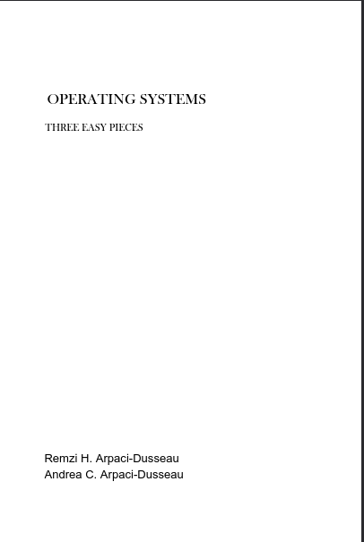

# kernel-learning
đây là repo tôi dùng để viết các writeup về kernel và tầng thấp của hệ thống linux, kết hợp với sách OSTEP. Một cuốn sách thiên về căn bản của kernel thuộc hệ thống linux :

<table>
<tr>
<td align="center" valign="top">

**OSTEP - Operating Systems: Three Easy Pieces**

là một trong những cuốn sách giáo trình kinh điển và phổ biến nhất thế giới về Hệ điều hành, được viết bởi hai giáo sư `Remzi Arpaci-Dusseau` và `Andrea Arpaci-Dusseau` thuộc Đại học `Wisconsin-Madison`.

Cuốn sách là kết quả đúc kết từ gần 25 năm kinh nghiệm giảng dạy môn Hệ điều hành nhập môn (CS 537) cho sinh viên đại học và cao học của hai tác giả tại Đại học `Wisconsin-Madison`
  
</td>

<td>
<kbd>

</kbd>
</td>

</tr>
</table>

Giới thiệu sơ qua về cuốn OSTEP, nó dạy về gì, nó chỉ xoay quanh 3 trục chính đó là ảo hóa, xử lý đồng thời và lưu trữ bền vứng. Ngoài ra, writeup này ko chỉ giới thiệu và viết về nội dung trong sách, tôi còn lấy những khái niệm, system calls, và nhiều API hệ điều hành khác thiên về kernel để cung cấp vào sao cho tạo nên một hệ sinh thái cơ sở thông tin bền vững và chuyên sâu học thuật nhất có thể
