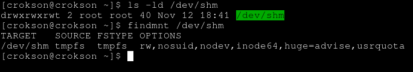
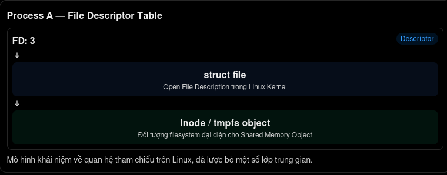
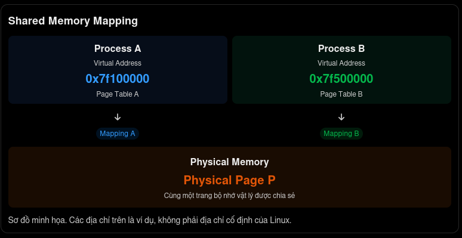
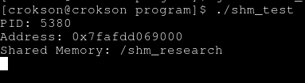
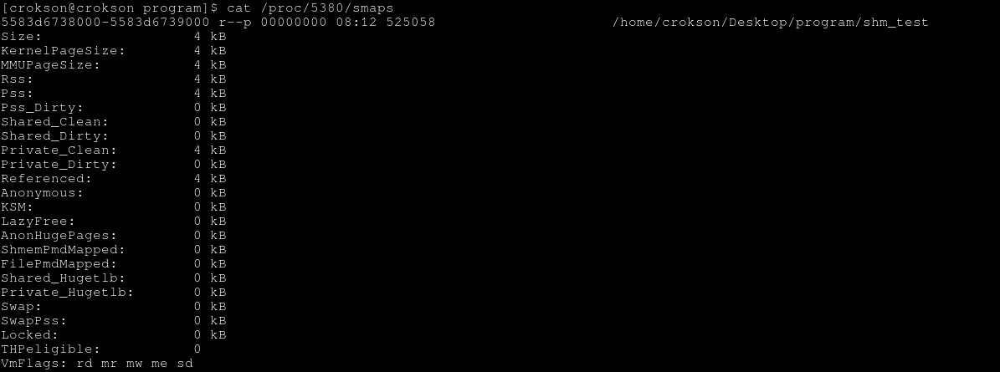

# Kernel : Chuyên đề `MAP_SHARED` (`MAP_SHARED` Thematic Research)

**Mục lục**

<table>
<tr>
<td valign="top" width="50%">

- [1.Tổng quan về POSIX Shared Memory](#1tổng-quan-về-posix-shared-memory)
  - [1.1. Shared Memory là gì?](#11-shared-memory-là-gì)
  - [1.2. Shared Memory trong IPC](12-shared-memory-trong-ipc)
     - [1.2.1. IPC là gì?](#121-ipc-là-gì)
	 - [1.2.2. Shared Memory hoạt động như thế nào?](#122-shared-memory-hoạt-động-như-thế-nào)
  - [1.3. So sánh Shared Memory với Pipe, FIFO và Socket](#13-so-sánh-shared-memory-với-pipe-fifo-và-socket)
  - [1.4. Kiến trúc tổng thể giữa User Space và Kernel Space](#14-kiến-trúc-tổng-thể-giữa-user-space-và-kernel-space)
	 - [1.4.1. User Space và Kernel Space là gì?](#141-user-space-và-kernel-space-là-gì)
	 - [1.4.2. Vai trò của User Space trong POSIX Shared Memory](#142-vai-trò-của-user-space-trong-posix-shared-memory)
	 - [1.4.3. Vai trò của Linux Kernel](#143-vai-trò-của-linux-kernel)
- [2.Shared Memory Object](#2shared-memory-object)
  - [2.1. Shared Memory Object là gì?](#21-shared-memory-object-là-gì)
    - [2.1.1. Các thành phần cấu thành Shared Memory Object](#211-các-thành-phần-cấu-thành-shared-memory-object)
  - [2.2. Namespace và tên đối tượng](#22-namespace-và-tên-đối-tượng)
    - [2.2.1. POSIX Shared Memory Namespace là gì?](#221-posix-shared-memory-namespace-là-gì)
    - [2.2.2. Quy tắc đặt tên POSIX Shared Memory](#222-quy-tắc-đặt-tên-posix-shared-memory)
    - [2.2.3. Linux ánh xạ POSIX Shared Memory Namespace vào `/dev/shm`](#223-linux-ánh-xạ-posix-shared-memory-namespace-vào-devshm)
    - [2.2.4. Namespace và phạm vi truy cập giữa các Process](#224-namespace-và-phạm-vi-truy-cập-giữa-các-process)
    - [2.2.5. Trùng tên và cơ chế tạo object](#225-trùng-tên-và-cơ-chế-tạo-object)
    - [2.2.6. Vòng đời của tên đối tượng](#226-vòng-đời-của-tên-đối-tượng)
  - [2.3. File Descriptor và vòng đời đối tượng (File Descriptor and Object Lifecycle)](#23-file-descriptor-và-vòng-đời-đối-tượng-file-descriptor-and-object-lifecycle)
    - [2.3.1. File Descriptor trong POSIX Shared Memory là gì?](#231-file-descriptor-trong-posix-shared-memory-là-gì)
    - [2.3.2. Kiến trúc quản lý File Descriptor trong Linux](#232-kiến-trúc-quản-lý-file-descriptor-trong-linux)
    - [2.3.3. Quan hệ giữa File Descriptor và Shared Memory Object](#233-quan-hệ-giữa-file-descriptor-và-shared-memory-object)
    - [2.3.4. Quan hệ giữa `close()` và Shared Memory Object](#234-quan-hệ-giữa-close-và-shared-memory-object)
    - [2.3.5. Quan hệ giữa `shm_unlink()` và vòng đời đối tượng](#235-quan-hệ-giữa-shm-unlink-và-vòng-đời-đối-tượng)
    - [2.3.6. `fork()` và `dup()` ảnh hưởng thế nào đến File Descriptor?](#236-fork-và-dup-ảnh-hưởng-thế-nào-đến-file-descriptor)
  - [2.4. Quan hệ giữa Shared Memory Object và Virtual Memory Area (VMA)](#24-quan-hệ-giữa-shared-memory-object-và-virtual-memory-area-vma)
    - [2.4.1. Virtual Memory Area là gì?](#241-virtual-memory-area-là-gì)
    - [2.4.2. Quan hệ giữa Shared Memory Object và VMA](#242-quan-hệ-giữa-shared-memory-object-và-vma)
    - [2.4.3. Một Shared Memory Object có thể được ánh xạ vào nhiều VMA](#243-một-shared-memory-object-có-thể-được-ánh-xạ-vào-nhiều-vma)
    - [2.4.4. Quan hệ giữa VMA, Page Table và Physical Memory](#244-quan-hệ-giữa-vma-page-table-và-physical-memory)
    - [2.4.5. Trường `vm_file` và `vm_pgoff` trong `struct vm_area_struct`](#245-trường-vm_file-và-vm_pgoff-trong-struct_vm_area_struct)
    - [2.4.6. Một Object có thể có nhiều VMA trong cùng một Process không?](#246-một-object-có-thể-có-nhiều-vma-trong-cùng-một-process-không)
    - [2.4.7. `munmap()` và tác động lên VMA](#247-munmap-và-tác-động-lên-vma)
  - [2.5. Backing storage và Page Cache trên Linux](#25-backing-storage-và-page-cache-trên-linux)
    - [2.5.1. Backing Storage là gì?](#251-backing-storage-là-gì)
    - [2.5.2. `tmpfs` và `shmem` trong Linux](#252-tmpfs-và-shmem-trong-linux)
    - [2.5.3. Page Cache là gì?](#253-page-cache-là-gì)
    - [2.5.4. `struct address_space` và mối liên hệ với Page Cache](#254-struct-address_space-và-mối-liên-hệ-với-page-cache)
    - [2.5.5. `struct page` và `struct folio`](#255-struct-page-và-struct-folio)
    - [2.5.6. Demand Paging: Khi nào Backing Pages được đưa vào RAM?](#256-demand-paging-khi-nào-backing-pages-được-đưa-vào-ram)
    - [2.5.7. Cơ chế chia sẻ Backing Pages giữa nhiều Process](#257-cơ-chế-chia-sẻ-backing-pages-giữa-nhiều-process)
    - [2.5.8. `tmpfs`, `Swap` và vòng đời Physical Pages](#258-tmpfs-swap-và-vòng-đời-physical-pages)
    - [2.5.9. Thực nghiệm: Quan sát Shared Memory qua `/proc` và `smaps`](#259-thực-nghiệm-quan-sát-shared-memory-qua-proc-và-smaps)
- 3. `shm_open()`
  - 3.1. Function prototype
  - 3.2. Tham số `name`, `oflag`, `mode`
  - 3.3. `O_CREAT`, `O_EXCL`, `O_RDWR`
  - 3.4. Cơ chế tạo và mở Shared Memory Object
  - 3.5. File descriptor được trả về
  - 3.6. Error handling
  - 3.7. Phân tích System Call và Kernel implementation
- 4.`ftruncate()`
  - 4.1. Function prototype
  - 4.2. Tại sao cần thiết lập kích thước?
  - 4.3. Thay đổi kích thước đối tượng shared memory
  - 4.4. Quan hệ giữa object size và mapping length
  - 4.5. File metadata và kernel implementation
  - 4.6. Các lỗi thường gặp
  - 4.7. Phân tích hành vi khi truy cập vùng mapping vượt kích thước đối tượng

</td>
<td valign="top" width="50%">

- 5.`mmap()` với POSIX Shared Memory
  - 5.1. Mapping Shared Memory Object vào Virtual Address Space
  - 5.2. `MAP_SHARED` và `PROT_READ | PROT_WRITE`
  - 5.3. File descriptor trong `mmap()`
  - 5.4. VMA và Page Table
  - 5.5. Demand Paging
  - 5.6. Page Cache và các mapping dùng chung
  - 5.7. Quan sát bằng GDB và `/proc/PID/maps`
- 6.`shm_unlink()`
  - 6.1. Function prototype
  - 6.2. Xóa tên Shared Memory Object
  - 6.3. Khác biệt giữa `shm_unlink()` và `close()`
  - 6.4. Khác biệt giữa `shm_unlink()` và `munmap()`
  - 6.5. Reference counting và vòng đời object
  - 6.6. Khi nào bộ nhớ thực sự được giải phóng?
  - 6.7. Phân tích kernel implementation
- 7.Vòng đời Shared Memory
  - 7.1. Tạo object
  - 7.2. Thiết lập kích thước
  - 7.3. Mapping vào các tiến trình
  - 7.4. Trao đổi dữ liệu
  - 7.5. Đồng bộ hóa giữa các tiến trình
  - 7.6. Unlink và giải phóng tài nguyên
- 8.Đồng bộ hóa (Synchronization)
  - 8.1. Race Condition
  - 8.2. Tín hiệu cờ POSIX (POSIX Semaphore)
  - 8.3. Mutex dùng chung giữa các tiến trình (Process-shared Mutex)
	 - 8.3.1. Mutex là gì?
  - 8.4. Sắp xếp bộ nhớ (Memory Ordering)
  - 8.5. Đồng bộ hóa và tính nhất quán dữ liệu
- 9.Thực nghiệm và Debugging
  - 9.1. Hai tiến trình độc lập sử dụng Shared Memory
  - 9.2. Quan sát Virtual Address Space
  - 9.3. Kiểm tra `/proc/PID/maps`
  - 9.4. Kiểm tra `/proc/PID/smaps`
  - 9.5. GDB: Theo dõi thao tác đọc/ghi
  - 9.6. Theo dõi System Call bằng strace
  - 9.7. Thực nghiệm vòng đời object

</td>
</tr>
</table>

---

## 1.Tổng quan về POSIX Shared Memory
### 1.1. Shared Memory là gì?

là một cơ chế Inter-Process Communication (IPC) cho phép nhiều tiến trình (process) cùng truy cập vào một vùng bộ nhớ chung. Đặc điểm chính
- Nó có tốc độ rất cao vì dữ liệu không cần copy qua kernel (khác với pipe, message queue…).
- Các tiến trình đọc/ghi trực tiếp trên cùng một vùng nhớ.
- Thường dùng kết hợp với cơ chế đồng bộ (semaphore, mutex, condition variable…) để tránh race condition.

Các hàm POSIX chính

<div align="center">

| Hàm | Mục đích |
|:-:|:-|
| `shm_open()` | Tạo hoặc mở một shared memory object |
| `ftruncate()` | Đặt kích thước cho shared memory |
| `mmap()` | Ánh xạ shared memory vào không gian địa chỉ của process |
| `munmap()` | Hủy ánh xạ |
| `shm_unlink()` | Xóa shared memory object |
| `close()` | Đóng file descriptor |

</div>

### 1.2. Shared Memory trong IPC

là một trong những cơ chế giao tiếp giữa các tiến trình (Inter-Process Communication) nhanh nhất.

#### 1.2.1. IPC là gì?

IPC (Inter-Process Communication) là tập hợp các kỹ thuật cho phép các process trao đổi dữ liệu và đồng bộ với nhau. Các cơ chế IPC phổ biến gồm:

<div align="center">

| Cơ chế | Tốc độ | Độ phức tạp | Sao chép dữ liệu | Ghi chú |
|-|-|-|-|-|
| Shared Memory | Rất nhanh | Trung bình | Không | Nhanh nhất |
| Pipe / Named Pipe | Trung bình | Thấp | Có | Dễ dùng |
| Message Queue | Trung bình | Trung bình | Có | Có cấu trúc |
| Socket | Chậm hơn | Cao | Có | Có thể dùng mạng |
| Signal | Nhanh | Thấp | Không | Chỉ thông báo |

</div>

#### 1.2.2. Shared Memory hoạt động như thế nào?

Hệ thống tạo một vùng nhớ chung (shared memory region). Các process ánh xạ (map) vùng nhớ này vào không gian địa chỉ của riêng chúng. Sau đó chúng có thể đọc/ghi trực tiếp trên cùng một vùng nhớ từ đó không cần copy dữ liệu qua kernel.

- **Ưu điểm**
  - Tốc độ cao nhất trong các cơ chế IPC (không phải copy dữ liệu).
  - Phù hợp khi cần truyền lượng dữ liệu lớn hoặc truy cập thường xuyên.
- **Nhược điểm**
  - **Không tự đồng bộ:** Dễ bị race condition nếu không dùng thêm cơ chế đồng bộ (semaphore, mutex, condition variable…).
  - Khó quản lý hơn so với pipe hay message queue.
  - Cần xử lý cẩn thận việc tạo, xóa và quyền truy cập.

### 1.3. So sánh Shared Memory với Pipe, FIFO và Socket

đây là bảng so sánh các cơ chế IPC phổ biến:

<div align="center">

| Tiêu chí | Shared Memory | Pipe (Unnamed) | FIFO (Named Pipe) | Socket |
|-|-|-|-|-|
| Tốc độ | Rất nhanh (nhanh nhất) | Trung bình | Trung bình | Chậm hơn (nhất là network) |
| Sao chép dữ liệu | Không | Có (qua kernel) | Có (qua kernel) | Có (qua kernel) |
| Hướng truyền | Hai chiều (tùy cách dùng) | Một chiều | Một chiều (thường) | Hai chiều |
| Đồng bộ | Phải tự làm (semaphore…) | Kernel hỗ trợ một phần | Kernel hỗ trợ một phần | Kernel hỗ trợ tốt |
| Process liên quan | Bất kỳ process nào | Thường là quan hệ cha-con | Bất kỳ process nào | Bất kỳ (kể cả khác máy) |
| Tồn tại sau khi process kết thúc | Có (cần `shm_unlink`) | Không | Có (nằm trên filesystem) | Không |
| Độ phức tạp lập trình | Cao | Thấp | Trung bình | Trung bình đến cao |
| Phạm vi | Chỉ trong máy | Chỉ trong máy | Chỉ trong máy | Trong máy hoặc qua mạng |
| Kiểu dữ liệu | Bộ nhớ thô (byte) | Byte stream | Byte stream | Stream hoặc Datagram |

</div>

Dựa vào bảng là tóm tắt, chúng ta phân tích chi tiết độ khác nhau giữa 4 cơ chế IPC :

- 1.Shared Memory
  - **Ưu điểm:** Tốc độ cao nhất vì process đọc/ghi trực tiếp trên cùng vùng nhớ, không phải copy dữ liệu.
  - **Nhược điểm:** Không có cơ chế đồng bộ sẵn nên dễ bị race condition. Phải dùng thêm semaphore/mutex.
  - **Phù hợp:** Khi cần truyền dữ liệu lớn hoặc truy cập rất thường xuyên (xử lý ảnh, video, cache…).
- 2.Pipe (Unnamed Pipe)
  - Chỉ dùng được giữa các process có quan hệ (thường là cha – con).
  - Một chiều (một đầu đọc, một đầu ghi).
  - Đơn giản, an toàn hơn Shared Memory vì kernel quản lý buffer.
  - **Phù hợp:** Truyền dữ liệu đơn giản giữa process cha và con.
- 3.FIFO (Named Pipe)
  - Giống Pipe nhưng có tên trong filesystem nên các process không liên quan vẫn dùng được.
  - Vẫn là byte stream, một chiều.
  - Tồn tại trên đĩa (thực ra là special file), nên có thể mở lại sau khi process kết thúc.
  - **Phù hợp:** Khi cần giao tiếp giữa các process độc lập trên cùng máy mà không muốn dùng Shared Memory.
- 4.Socket
  - **Linh hoạt nhất:** dùng được cả local (Unix Domain Socket) lẫn qua mạng (TCP/UDP).
  - Hai chiều, hỗ trợ tốt việc đồng bộ và điều khiển luồng.
  - Chi phí cao hơn vì phải qua nhiều lớp (đặc biệt khi dùng network).
  - **Phù hợp:** Khi cần giao tiếp phức tạp, hoặc giữa các máy khác nhau, hoặc muốn giao diện thống nhất (local + remote).

### 1.4. Kiến trúc tổng thể giữa User Space và Kernel Space
#### 1.4.1. User Space và Kernel Space là gì?

Khái niệm user space (hay còn gọi là userland) là không gian mà các chương trình ứng dụng của người dùng chạy trong hệ điều hành. Đây là không gian người dùng, khá hạn chế và nó ko được phép truy cập tới phần cứng. Cho ví dụ là khi bạn mở một trình duyệt firefox và thao tác trên đó, thì nó đang ở userland, còn mà khi nó muốn gọi hay gửi dữ liệu qua mạng, nó cần call API linux, lúc này system call xuống kernel (trong kernel space) để xử lý giúp 

Khái niệm kernel space (ko gian nhãn) là vùng bộ nhớ và môi trường thực thi dành riêng cho nhân hệ điều hành (kernel). Đây là không gian có đặc quyền cao nhất (privileged mode / ring 0), có quyền truy cập toàn bộ phần cứng: (CPU, RAM, ổ đĩa, card mạng, GPU...) Quản lý tài nguyên hệ thống: bộ nhớ, tiến trình, file system, driver thiết bị, bảo mật…

Code trong kernel space nếu bị lỗi thường làm sập cả hệ thống (kernel panic / BSOD). Chỉ kernel và các module/driver được tải vào kernel mới chạy ở đây.

#### 1.4.2. Vai trò của User Space trong POSIX Shared Memory

Trong kiến trúc POSIX Shared Memory trên Linux, User Space (không gian người dùng) là môi trường thực thi các chương trình ứng dụng có nhu cầu sử dụng cơ chế chia sẻ bộ nhớ giữa nhiều tiến trình (Inter-Process Communication - IPC).Tại đây, chương trình không trực tiếp quản lý Physical Memory hay Page Table của hệ thống. Thay vào đó, nó sử dụng các giao diện lập trình (API) do POSIX cung cấp để yêu cầu Kernel thực hiện những thao tác liên quan đến việc tạo, quản lý và ánh xạ vùng bộ nhớ dùng chung.

Có thể hiểu rằng User Space chịu trách nhiệm đưa ra các yêu cầu và sử dụng vùng Shared Memory sau khi được ánh xạ thành công, trong khi Linux Kernel chịu trách nhiệm quản lý những tài nguyên hệ thống phía sau.

- **a.Chương trình ứng dụng (Application):** Ở User Space, mọi hoạt động sử dụng POSIX Shared Memory đều bắt đầu từ chương trình ứng dụng. **Ví dụ**, một chương trình C có thể sử dụng các thư viện và header sau:

  ```c
  #include <stdio.h>
  #include <stdlib.h>
  #include <fcntl.h>
  #include <sys/mman.h>
  #include <sys/stat.h>
  #include <unistd.h>
  ```

  Các header này cung cấp những khai báo cần thiết để chương trình sử dụng các API liên quan đến POSIX Shared Memory. Một quy trình sử dụng cơ bản:

  ```c
  int fd = shm_open("/my_shm", O_CREAT | O_RDWR, 0666);

  ftruncate(fd, 4096);

  void *ptr = mmap(
      NULL,
      4096,
      PROT_READ | PROT_WRITE,
      MAP_SHARED,
      fd,
      0
  );
  ```

  Trong đoạn chương trình trên:
  - `shm_open()` yêu cầu tạo hoặc mở một Shared Memory Object và trả về file descriptor.
  - `ftruncate()` yêu cầu thiết lập kích thước object thành 4096 bytes.
  - `mmap()` yêu cầu ánh xạ object vào Virtual Address Space của tiến trình.

> [!NOTE]
> **Lưu ý:** Đây là ví dụ minh họa các thao tác API, chưa phải chương trình hoàn chỉnh vì chưa kiểm tra lỗi và giải phóng tài nguyên.

- **b.thư viện C (C Library - glibc):** Các chương trình C thông thường không trực tiếp tự xây dựng cơ chế System Call cho từng thao tác. Thay vào đó, chúng sử dụng các hàm thư viện được cung cấp bởi C Library, chẳng hạn glibc trên Linux. **Ví dụ:**

  ```c
  shm_open();
  ftruncate();
  mmap();
  munmap();
  shm_unlink();
  ```

  Các API này cung cấp giao diện lập trình thuận tiện để ứng dụng tương tác với những cơ chế quản lý tài nguyên của Kernel.

  **Một điểm cần phân biệt:** không nên mặc định rằng mỗi API tương ứng với đúng một System Call. Chẳng hạn, `shm_open()` trên Linux thường được triển khai thông qua các thao tác filesystem như `openat()`, chứ không nhất thiết có một System Call riêng mang tên `shm_open`.
- **c. Quản lý File Descriptor:** Sau khi gọi `shm_open()` thành công, chương trình nhận được một giá trị int đại diện cho File Descriptor (FD). **Ví dụ:**

  ```c
  int fd = shm_open("/my_shm", O_CREAT | O_RDWR, 0666);
  ```

  Giá trị fd là một định danh mà tiến trình sử dụng để tham chiếu đến một file description do Kernel quản lý. File Descriptor cho phép chương trình thực hiện những thao tác tiếp theo trên Shared Memory Object, chẳng hạn:
  - Thiết lập kích thước thông qua `ftruncate()`.
  - Ánh xạ object thông qua `mmap()`.
  - Đóng descriptor thông qua `close()`.

> [!IMPORTANT]
> Điều quan trọng là File Descriptor không phải địa chỉ bộ nhớ của Shared Memory. Nó chỉ là một định danh trong bảng File Descriptor của tiến trình.

- **d. Sử dụng Shared Memory sau khi Mapping:** Sau khi `mmap()` thành công, chương trình nhận được một Virtual Address trỏ đến vùng nhớ đã ánh xạ. **Ví dụ:**

  ```c
  char *ptr = mmap(
      NULL,
      4096,
      PROT_READ | PROT_WRITE,
      MAP_SHARED,
      fd,
      0
  );
  
  if (ptr == MAP_FAILED) {
      perror("mmap");
      exit(EXIT_FAILURE);
  }

  ptr[0] = 'A';
  ptr[1] = 'B';
  ```

  Ở đây, `ptr` là một địa chỉ Virtual Address thuộc không gian địa chỉ của tiến trình hiện tại. Khi chương trình thực hiện `ptr[0] = 'A';`, CPU thực hiện thao tác ghi bộ nhớ thông qua cơ chế dịch địa chỉ Virtual Address sang Physical Address. Nếu trang bộ nhớ tương ứng đã được ánh xạ và truy cập hợp lệ, CPU có thể ghi trực tiếp vào Physical Page tương ứng mà không cần thực hiện một System Call riêng cho mỗi lần ghi.

> [!IMPORTANT]
> **Đây là điểm rất quan trọng:** System Call được sử dụng để thiết lập mapping, nhưng các thao tác đọc/ghi dữ liệu thông thường sau đó diễn ra trực tiếp thông qua cơ chế truy cập bộ nhớ của CPU.

- **e. Trách nhiệm của User Space:** Tổng hợp lại, User Space chịu trách nhiệm:
  - **Application:** Quyết định cách sử dụng Shared Memory
  - **POSIX API:** Cung cấp giao diện thao tác với Shared Memory
  - **C Library:** Cung cấp implementation của API
  - **File Descriptor:** Tham chiếu đến object được Kernel quản lý
  - **Virtual Address:** Địa chỉ để chương trình truy cập vùng mapping
  - **Synchronization:** Tổ chức đồng bộ giữa các process
  - **Error Handling:** Kiểm tra và xử lý lỗi từ các API

User Space không trực tiếp quản lý cách Kernel cấp phát Physical Pages, thiết lập Page Table hay quản lý VMA. Nó chỉ tương tác với những tài nguyên này thông qua các giao diện được hệ điều hành cung cấp.Sau khi mapping thành công, chương trình có thể truy cập dữ liệu thông qua Virtual Address như cách nó truy cập một vùng bộ nhớ thông thường. Chính cơ chế này cho phép nhiều tiến trình độc lập cùng thao tác trên một vùng Physical Memory được chia sẻ.

#### 1.4.3. Vai trò của Linux Kernel

Trong kiến trúc POSIX Shared Memory, Linux Kernel (nhân hệ điều hành Linux) đóng vai trò quản lý và điều phối toàn bộ tài nguyên hệ thống cần thiết để triển khai cơ chế chia sẻ bộ nhớ giữa các tiến trình. Nếu User Space chịu trách nhiệm gọi API, thiết lập yêu cầu và sử dụng vùng nhớ sau khi mapping, thì Kernel chịu trách nhiệm xử lý những yêu cầu đó, quản lý Shared Memory Object, tổ chức ánh xạ bộ nhớ ảo và đảm bảo các tiến trình có thể truy cập đến cùng một vùng dữ liệu vật lý.

Để hiểu rõ hơn, cần phân tích các thành phần mà Kernel quản lý trong quá trình POSIX Shared Memory hoạt động.

- **a. Quản lý Shared Memory Object:** Khi một chương trình gọi `shm_open()`, yêu cầu tạo hoặc mở một Shared Memory Object được chuyển đến Kernel thông qua các giao diện hệ thống. Trên Linux, POSIX Shared Memory thường được triển khai dựa trên `tmpfs`, thường được mount tại `/dev/shm`. **Ví dụ:**

  ```c
   int fd = shm_open("/my_shm", O_CREAT | O_RDWR, 0666);
  ```

  Ở mức triển khai Linux, tên `/my_shm` thường tương ứng với một đối tượng filesystem có tên `my_shm` bên trong `/dev/shm`. Kernel chịu trách nhiệm:
  - Tra cứu tên object trong namespace tương ứng.
  - Kiểm tra quyền truy cập.
  - Tạo mới hoặc mở object đã tồn tại.
  - Quản lý metadata của object.
  - Duy trì các tham chiếu đến object trong suốt vòng đời sử dụng.

  Cần phân biệt rằng Shared Memory Object không đơn giản là một vùng địa chỉ Virtual Memory. Nó là một đối tượng được quản lý bởi Kernel, có thể được nhiều tiến trình mở và ánh xạ vào không gian địa chỉ riêng của chúng.

<details>
	<summary><b>[Câu hỏi]</b> /dev/shm là gì ở linux?</summary>
<table>
<tr>
<td>

---

`/dev/shm` là một thư mục đặc biệt trên Linux, thường được sử dụng làm mount point cho filesystem `tmpfs`, nhằm cung cấp không gian lưu trữ cho các đối tượng POSIX Shared Memory.

**Nói đơn giản:** khi một chương trình sử dụng `shm_open()` để tạo POSIX Shared Memory Object, trên Linux, đối tượng đó thường được biểu diễn bằng một filesystem object nằm trong `/dev/shm`.

Điều này tạo ra mối liên hệ trực tiếp giữa POSIX Shared Memory API và cơ chế filesystem của Linux.

- **`/dev/shm` nằm ở đâu trong linux?:** Trên Linux, /dev/shm là một đường dẫn thuộc filesystem hierarchy (Cấu trúc phân cấp hệ thống tệp). **Ví dụ:**

  ```bash
  $ ls -ld /dev/shm
  drwxrwxrwt 2 root root 40 Nov 12 20:00 /dev/shm
  ```

  Kiểm tra filesystem đang được mount:

  ```bash
  $ findmnt /dev/shm
  ```

  một kết quả thường gặp:

  ```bash
  TARGET   SOURCE FSTYPE OPTIONS
  /dev/shm tmpfs  tmpfs  rw,nosuid,nodev,inode64
  ```

  Trong đó:
  - `/dev/shm`: Mount point
  - `tmpfs`: Filesystem lưu trữ dữ liệu trong bộ nhớ ảo
  - `rw`: Cho phép đọc và ghi
  - `nosuid`: Không áp dụng hiệu lực SUID/SGID từ file trên filesystem
  - `nodev`: Không cho phép sử dụng device special files

  **Lưu ý:** `tmpfs` không phải một phân vùng ổ đĩa vật lý. Nó sử dụng cơ chế quản lý bộ nhớ của Kernel và có thể sử dụng swap khi cần.

<details>
<summary><b>[Chi tiết]</b> Thử với hệ thống thật</summary>

---

Kết quả:

<p align="center">

</p>

Ở đây ta thấy 

```bash
TARGET   SOURCE FSTYPE OPTIONS
/dev/shm tmpfs  tmpfs  rw,nosuid,nodev,inode64,huge=advise,usrquota
```

Phần options, nó có nghĩa là :

- `rw`: Mount ở chế độ read-write (đọc + ghi được).
- `nosuid`: Không cho phép các bit SUID/SGID có hiệu lực trên filesystem này. (An toàn hơn, tránh privilege escalation)
- `nodev`: Không cho phép sử dụng device file (character/block device) trên filesystem này.
- `inode64`: Sử dụng 64-bit inode number. Tránh bị giới hạn số lượng inode khi filesystem rất lớn (mặc dù `/dev/shm` là `tmpfs`).
- `huge=advise`: Liên quan đến Transparent Huge Pages (THP). Chế độ `advise` nghĩa là kernel sẽ cố gắng dùng huge page nếu có thể, nhưng không bắt buộc.
- `usrquota`: Bật user quota (giới hạn dung lượng theo từng user).

Suy ra, đây là cấu hình mount khá an toàn và phổ biến của `/dev/shm` (`tmpfs` trên RAM). Cho phép đọc/ghi , tắt SUID và device file (bảo mật), hỗ trợ inode 64-bit, có bật Transparent Huge Pages ở mức advise, có bật user quota

<sub>--đã hết phần giải thích--</sub>

---

</details>

- **Mối quan hệ giữa `/dev/shm` và POSIX Shared Memory:** Để hiểu rõ vai trò của `/dev/shm`, hãy xét một chương trình C sử dụng `shm_open()`:

  ```c
  int fd = shm_open("/my_shm", O_CREAT | O_RDWR, 0666);
  ```

  Ở đây, chương trình yêu cầu Kernel tạo một POSIX Shared Memory Object có tên `/my_shm`. Trên Linux, tên này thường được ánh xạ thành một filesystem object chẳng hạn như `/dev/shm/my_shm`. Có thể quan sát nó với lệnh `ls -l /dev/shm/`, nếu object tồn tại, chúng ta có thể nhìn thấy tên `my_shm` trong danh sách.

- **Tại sao Linux sử dụng tmpfs cho `/dev/shm`?:** Có một lý do quan trọng Shared Memory cần một đối tượng backing để nhiều tiến trình có thể cùng ánh xạ và truy cập dữ liệu. `tmpfs` cung cấp cơ chế filesystem object kết hợp với hệ thống quản lý bộ nhớ ảo của Linux. Một số đặc điểm:
  - Không cần tạo phân vùng ổ đĩa riêng.
  - Hỗ trợ tạo và quản lý filesystem object.
  - Có thể ánh xạ object vào Virtual Address Space thông qua `mmap()`.
  - Dữ liệu có thể được nhiều tiến trình cùng truy cập.
  - Có thể sử dụng swap khi hệ thống cần.

  Tuy nhiên, đừng hiểu rằng toàn bộ dữ liệu trong `/dev/shm` luôn nằm cố định trong RAM. `tmpfs` sử dụng bộ nhớ ảo và có khả năng swap.

<sub>--đã hết phần giải thích--</sub>

---

</td>
</tr>
</table>
</details>

- **b. Quản lý File Descriptor và Open File Description:** Sau khi `shm_open()` thành công, Kernel trả về một File Descriptor cho tiến trình gọi. **Ví dụ:**

  ```c
  int fd = shm_open("/my_shm", O_CREAT | O_RDWR, 0666);
  ```

  Giá trị fd được sử dụng làm chỉ mục trong File Descriptor Table của tiến trình. Ở cấp độ kernel, có thể hình dung mô hình mối quan hệ như sau:

  <p align="center">
	
  </p>

  Một số khái niệm cần phân biệt:
  - **File Descriptor:** Số nguyên đại diện cho một mục trong bảng FD của process
  - **struct file:** Biểu diễn một lần mở file ở cấp Kernel
  - **Inode:** Biểu diễn đối tượng filesystem và metadata của nó
  - **Shared Memory Object:** Đối tượng POSIX Shared Memory được truy cập thông qua filesystem

> [!IMPORTANT]
> **Điểm quan trọng:** Hai tiến trình có thể có hai File Descriptor khác nhau nhưng cùng tham chiếu đến một Shared Memory Object.

- **c. Quản lý Virtual Memory Area (VMA):** Khi chương trình gọi `mmap()`, Kernel tiến hành thiết lập một vùng mapping trong Virtual Address Space của tiến trình. **Ví dụ:**

```c
void *ptr = mmap(
    NULL, //cho kernel lựa vaddr
    4096,//4KB
    PROT_READ | PROT_WRITE, //đọc và ghi
    MAP_SHARED, //chia sẻ
    fd, //file descriptor
    0 //offset=0
);
```

Nếu thành công, Kernel tạo hoặc thiết lập một vùng Virtual Memory Area (VMA) tương ứng với mapping đó. Trên Linux, VMA được biểu diễn bởi cấu trúc `struct vm_area_struct`. VMA chứa những thông tin quan trọng như:
- Phạm vi địa chỉ ảo của vùng mapping.
- Quyền truy cập bộ nhớ.
- Các cờ mapping như `VM_SHARED`.
- Thông tin liên kết đến đối tượng file backing mapping.
- Offset tương ứng trong đối tượng được ánh xạ.

**Ví dụ về mặt khái niệm:**

```
Process A
Virtual Address Space

0x7f100000 ┌─────────────────────┐
           │                     │
           │   Shared Memory     │
           │                     │
0x7f101000 └─────────────────────┘
```

Process B có thể ánh xạ cùng object tại một địa chỉ hoàn toàn khác:

```
Process B
Virtual Address Space

0x7f500000 ┌─────────────────────┐
           │                     │
           │   Shared Memory     │
           │                     │
0x7f501000 └─────────────────────┘
```

Hai VMA thuộc hai tiến trình khác nhau, nhưng chúng có thể cùng tham chiếu đến một đối tượng backing memory.

- **d. Quản lý Physical Pages và Page Table:** Đây là một trong những nhiệm vụ quan trọng nhất của Kernel trong cơ chế Shared Memory. Virtual Address mà chương trình sử dụng không phải địa chỉ vật lý thực tế của RAM. CPU cần thông qua Memory Management Unit (MMU) để dịch địa chỉ ảo sang địa chỉ vật lý. Kernel chịu trách nhiệm thiết lập và quản lý các cấu trúc bộ nhớ ảo, bao gồm Page Table và các ánh xạ tương ứng. **Ví dụ, giả sử:**
  - Process A ánh xạ Shared Memory tại `0x7f100000`.
  - Process B ánh xạ Shared Memory tại `0x7f500000`.
  - Cả hai cùng truy cập một Physical Page.

  <p align="center">
	
  </p>

  Kết quả:
  - Process A ghi dữ liệu vào vùng mapping.
  - Dữ liệu được ghi vào Physical Page tương ứng.
  - Process B có thể đọc được dữ liệu đó thông qua mapping của chính nó.

  Đây là bản chất của cơ chế chia sẻ bộ nhớ: nhiều Virtual Address thuộc các tiến trình khác nhau có thể cùng ánh xạ đến một Physical Page.

> [!NOTE]
> **Lưu ý:** Việc thiết lập mapping không nhất thiết khiến toàn bộ Physical Pages được cấp phát ngay lập tức. Linux có thể sử dụng Demand Paging để chỉ xử lý trang khi thực sự được truy cập.

<details>
<summary><b>[Câu hỏi]</b> Demand Paging là gì?</summary>
<table>
<tr>
<td>

---


<sub>--đã hết phần giải thích--</sub>

---

</td>
</tr>
</table>
</details>

- **e. Quản lý Backing Storage và Page Cache:** Trên Linux, POSIX Shared Memory thường sử dụng tmpfs làm filesystem backing object. `tmpfs` là một filesystem sử dụng bộ nhớ ảo của Kernel để lưu trữ dữ liệu. Nội dung của nó thường nằm trong RAM, nhưng cũng có thể được swap ra ngoài khi hệ thống cần. Kernel quản lý:
  - Metadata của Shared Memory Object.
  - Các trang dữ liệu backing object.
  - Quan hệ giữa object và những mapping sử dụng object đó.
  - Việc cấp phát, thu hồi và quản lý các trang bộ nhớ.

  **Một điểm cần hiểu rõ:** Không nên đồng nhất `tmpfs` với một vùng RAM cố định. `tmpfs` sử dụng cơ chế quản lý bộ nhớ ảo của Linux, bao gồm cả khả năng sử dụng swap.
- **f. Quản lý vòng đời và giải phóng tài nguyên:** Kernel còn chịu trách nhiệm quản lý vòng đời của Shared Memory Object và các tài nguyên liên quan. **Ví dụ**, khi chương trình thực hiện:

  ```c
  munmap(ptr, 4096);
  close(fd);
  shm_unlink("/my_shm");
  ```

  Mỗi thao tác có ý nghĩa khác nhau:
  - `munmap()`: Hủy mapping trong Virtual Address Space
  - `close()`: Đóng File Descriptor
  - `shm_unlink()`: Xóa tên Shared Memory Object

  Việc gọi một trong các API trên không đồng nghĩa với việc toàn bộ Shared Memory được giải phóng ngay lập tức. Kernel phải xét đến những mapping, file reference và tham chiếu còn tồn tại trước khi có thể thu hồi tài nguyên tương ứng.

## 2.Shared Memory Object

Shared Memory Object (đối tượng bộ nhớ chia sẻ) là một đối tượng được hệ điều hành quản lý, đóng vai trò cung cấp tài nguyên bộ nhớ chung để nhiều tiến trình (process) có thể cùng mở và ánh xạ (mapping) vào Virtual Address Space của chúng.

Trong POSIX Shared Memory, Shared Memory Object là đối tượng trung tâm liên kết các thao tác `shm_open()`, `ftruncate()`, `mmap()` và `shm_unlink()`. Để hiểu rõ bản chất, cần phân biệt rằng Shared Memory Object không phải là một con trỏ bộ nhớ, cũng không phải một vùng Virtual Address cố định. Nó là một đối tượng có danh tính, metadata, kích thước và nội dung dữ liệu được quản lý thông qua cơ chế của hệ điều hành. Trên Linux, POSIX Shared Memory thường được triển khai thông qua filesystem `tmpfs`, với mount point mặc định là `/dev/shm`.

### 2.1. Shared Memory Object là gì?

Shared Memory Object là một đối tượng có tên (named object), được sử dụng làm backing object cho các vùng bộ nhớ được chia sẻ giữa nhiều tiến trình. **Ví dụ**, khi một chương trình gọi:

```c
int fd = shm_open(
    "/my_shm",
    O_CREAT | O_RDWR,
    0666
);
```

Linux sẽ tìm kiếm hoặc tạo một Shared Memory Object có tên `/my_shm`. Trên Linux, object này thường tương ứng với một filesystem object tại `/dev/shm/my_shm`. Sau khi tạo thành công, chương trình nhận được một File Descriptor (fd) để tham chiếu đến object.

Tuy nhiên, tại thời điểm này, cần phân biệt ba vấn đề:
- **Object tồn tại:** Kernel đã có đối tượng Shared Memory tương ứng.
- Object có kích thước: Được thiết lập thông qua `ftruncate()`.
- Object được ánh xạ: Được thực hiện thông qua `mmap()`.

Ba hoạt động này không xảy ra đồng thời và có mục đích khác nhau.

#### 2.1.1. Các thành phần cấu thành Shared Memory Object

Để hiểu Shared Memory Object ở cấp độ hệ điều hành, có thể phân tích các thành phần sau:
- **Inode:** Đại diện đối tượng filesystem và metadata
- **File Descriptor:** Cho phép process tham chiếu đến object
- **Object Size:** Kích thước logic của object
- **Backing Pages:** Các trang bộ nhớ lưu trữ nội dung object
- **Memory Mapping:** Quan hệ giữa object và Virtual Address Space của process

Không phải tất cả các thành phần trên đều nằm bên trong một cấu trúc dữ liệu duy nhất. Đây là các thành phần ở những tầng khác nhau của kiến trúc Linux.

### 2.2. Namespace và tên đối tượng (Namespace and Object Naming)
#### 2.2.1. POSIX Shared Memory Namespace là gì?

Trong POSIX Shared Memory, namespace là không gian định danh mà hệ điều hành sử dụng để phân biệt và tìm kiếm các Shared Memory Object thông qua tên của chúng. Khi một process muốn tạo hoặc mở một Shared Memory Object, nó không cần biết địa chỉ bộ nhớ ảo của object đó. Thay vào đó, process sử dụng một tên định danh thông qua hàm `shm_open()`. **Ví dụ:**

```c
int fd = shm_open("/my_shm", O_CREAT | O_RDWR, 0666);
```

Ở đây:
- `/my_shm` là tên định danh của Shared Memory Object.
- `O_CREAT` yêu cầu tạo object nếu nó chưa tồn tại.
- `O_RDWR` yêu cầu mở object với quyền đọc và ghi.
- `0666` là permission mode được áp dụng khi tạo object, sau khi xét umask.
- `fd` là file descriptor mà process nhận được nếu thao tác thành công.

> [!IMPORTANT]
> **Điểm quan trọng:** `/my_shm` không phải đường dẫn Virtual Address, cũng không phải địa chỉ vật lý. Nó là tên dùng để tra cứu một đối tượng trong namespace.

#### 2.2.2. Quy tắc đặt tên POSIX Shared Memory

POSIX quy định một số yêu cầu về tên Shared Memory Object.
- Phải bắt đầu bằng `/`: vì tên phải có dấu `/` ở đầu
- Không được có thêm `/`: vì tên portable chỉ có một dấu `/` ở đầu
- Phải có ít nhất một ký tự sau `/`: vì `/` đơn độc không phải tên hợp lệ
- Phân biệt chữ hoa và chữ thường `/MyShm` và `/myshm` là hai tên khác nhau

**Ví dụ:**

```c
shm_open("/my_shm", O_CREAT | O_RDWR, 0666);    // Hợp lệ
shm_open("/shared_memory", O_CREAT | O_RDWR, 0666); // Hợp lệ
shm_open("/MyShm", O_CREAT | O_RDWR, 0666);     // Hợp lệ
shm_open("my_shm", O_CREAT | O_RDWR, 0666);     // Không portable
shm_open("/my/shm", O_CREAT | O_RDWR, 0666);    // Không portable
shm_open("/", O_CREAT | O_RDWR, 0666);          // Không hợp lệ
```

> [!NOTE]
> **Lưu ý:** Đây là quy tắc tên theo POSIX, không nên đồng nhất nó với quy tắc đặt đường dẫn thông thường của Linux filesystem.

#### 2.2.3. Linux ánh xạ POSIX Shared Memory Namespace vào `/dev/shm`

POSIX quy định giao diện lập trình và cách ứng dụng sử dụng Shared Memory Object, nhưng không bắt buộc hệ thống phải lưu trữ chúng tại `/dev/shm`. Trên Linux, implementation POSIX Shared Memory thông thường sử dụng `tmpfs`, được mount tại `/dev/shm`. Do đó, khi gọi:

```c
shm_open("/my_shm", O_CREAT | O_RDWR, 0666);
```

nó thường tạo hoặc mở một filesystem object tương ứng với `/dev/shm/my_shm`. Có thể hình dung:

```
             User Space
        ┌──────────────────┐
        │    Process A     │
        │                  │
        │ shm_open()       │
        │ "/my_shm"        │
        └────────┬─────────┘
                 │
                 │ System call / libc
                 ▼
             Kernel Space
        ┌──────────────────┐
        │   VFS / tmpfs    │
        │                  │
        │  /dev/shm        │
        │      │           │
        │      ▼           │
        │   my_shm         │
        │                  │
        │ Shared Memory    │
        │ Object           │
        └──────────────────┘
```

Có thể kiểm tra trên Linux bằng `findmnt /dev/shm`. Kiểm tra các object hiện có `ls -lah /dev/shm/`. **Ví dụ:**

```
/dev/shm/
├── my_shm
├── shared_buffer
└── ipc_region
```

Các tên trên tương ứng với những filesystem object trong `tmpfs`. Chúng không phải các vùng Virtual Address của process. Đặc biệt là không được kết luận rằng POSIX bắt buộc Shared Memory phải nằm trong `/dev/shm`. Đây là cách triển khai phổ biến của Linux.

#### 2.2.4. Namespace và phạm vi truy cập giữa các Process

Điểm quan trọng của namespace là nhiều process có thể sử dụng cùng một tên để truy cập cùng một Shared Memory Object. **Ví dụ**, có hai process:

Process A:

```c
int fd = shm_open(
    "/shared_buffer",
    O_CREAT | O_RDWR,
    0666
);
```

Process B:

```c
int fd = shm_open(
    "/shared_buffer",
    O_RDWR,
    0666
);
```

Nếu cả hai process nhìn thấy cùng một POSIX Shared Memory namespace và object vẫn tồn tại, chúng có thể mở cùng một object. **Mô hình:**

```
       Process A                       Process B
┌────────────────────┐          ┌────────────────────┐
│ shm_open()         │          │ shm_open()         │
│ "/shared_buffer"   │          │ "/shared_buffer"   │
│                    │          │                    │
│ fd = 3             │          │ fd = 4             │
└─────────┬──────────┘          └─────────┬──────────┘
          │                               │
          └──────────────┬────────────────┘
                         │
                         ▼
             ┌──────────────────────┐
             │ Shared Memory Object │
             │                      │
             │    /shared_buffer    │
             └──────────────────────┘
```

Hai process có thể nhận được những file descriptor khác nhau, nhưng chúng vẫn tham chiếu đến cùng một Shared Memory Object. Đây là sự khác biệt quan trọng giữa:
- **Object name:** Tên định danh của object.
- **File descriptor:** Handle mà một process sử dụng để thao tác với object.
- **Virtual Address:** Địa chỉ mà process sử dụng sau khi gọi `mmap()`.

Ba thành phần này không thể thay thế cho nhau.

- **Namespace có luôn được chia sẻ giữa mọi process không?:** Không nhất thiết. Trên Linux, phạm vi nhìn thấy filesystem object còn phụ thuộc vào môi trường filesystem và mount namespace. **Ví dụ**, hai process ở hai container có thể nhìn thấy hai filesystem namespace khác nhau. Nếu `/dev/shm` của chúng được mount riêng, cùng tên `/my_shm` không nhất thiết trỏ đến cùng một object. Vì vậy, điều kiện quan trọng không chỉ là hai process sử dụng cùng tên, mà còn phải có khả năng truy cập cùng namespace chứa object đó.

#### 2.2.5. Trùng tên và cơ chế tạo object

Khi nhiều process cùng muốn tạo một Shared Memory Object, việc xử lý tên trùng lặp rất quan trọng. POSIX cung cấp các flag như `O_CREAT` và `O_EXCL`.

**Trường hợp 1:** Chỉ sử dụng `O_CREAT`:

```c
int fd = shm_open(
    "/shared_buffer",
    O_CREAT | O_RDWR, //chỉ dùng O_CREAT
    0666
);
```

- **Nếu object chưa tồn tại:** tạo object mới.
- **Nếu object đã tồn tại:** mở object hiện có.

**Trường hợp 2:** Sử dụng `O_CREAT | O_EXCL`:

```c
int fd = shm_open(
    "/shared_buffer",
    O_CREAT | O_EXCL | O_RDWR,
    0666
);
```

- **Nếu object chưa tồn tại:** tạo object mới.
- **Nếu object đã tồn tại:** thao tác thất bại và `errno` được đặt thành `EEXIST`.

Cơ chế này hữu ích khi một process cần đảm bảo rằng nó là process tạo object mới, thay vì vô tình mở một object đã được process khác tạo trước đó.

#### 2.2.6. Vòng đời của tên đối tượng

Tên của Shared Memory Object có vòng đời riêng, không đồng nhất với vòng đời của file descriptor hay memory mapping. **Ví dụ:**

```c
int fd = shm_open(
    "/shared_buffer",
    O_CREAT | O_RDWR,
    0666
);
```

Sau khi tạo object, process có thể thực hiện `ftruncate(fd, 4096);`


Tiếp theo, ánh xạ object vào Virtual Address Space:

```c
void *ptr = mmap(
    NULL,
    4096,
    PROT_READ | PROT_WRITE,
    MAP_SHARED,
    fd,
    0
);
```

Sau đó, process có thể xóa tên object `shm_unlink("/shared_buffer");`. Điều này không đồng nghĩa với việc vùng nhớ đã được ánh xạ lập tức biến mất.

<div align="center">

| Thao tác |	Tác động |
|-|-|
| `shm_open()` |	Tạo hoặc mở object theo tên |
| `close(fd)`	| Đóng file descriptor |
| `mmap()` |	Tạo memory mapping trong Virtual Address Space |
| `munmap()`	| Gỡ memory mapping |
| `shm_unlink()` |	Xóa tên object khỏi namespace |

</div>

Sau khi `shm_unlink()` thành công, process khác không thể mở object bằng tên cũ nữa. Tuy nhiên, các process đang giữ tham chiếu hợp lệ hoặc mapping tới object vẫn có thể tiếp tục sử dụng nó. Kernel chỉ có thể giải phóng object khi những tham chiếu cần thiết đã được giải phóng và không còn mapping giữ object tồn tại.

### 2.3. File Descriptor và vòng đời đối tượng (File Descriptor and Object Lifecycle)
#### 2.3.1. File Descriptor trong POSIX Shared Memory là gì?

Khi một process gọi `shm_open()` để tạo hoặc mở một POSIX Shared Memory Object, nếu thao tác thành công, kernel trả về một file descriptor (FD). File descriptor là một số nguyên không âm, được sử dụng làm định danh cho một tài nguyên đang được process mở. **Ví dụ:**

```c
int fd = shm_open(
    "/shared_buffer",
    O_CREAT | O_RDWR,
    0666
);
```

Giá trị fd có thể là `3`, `4`, `5` hoặc một số nguyên khác tùy thuộc vào những file descriptor mà process đang sử dụng. Trong Linux, ba file descriptor mặc định thường là:

- `0`: stdin là standard Input
- `1`: stdout là standard Output
- `2`: stderr là standard Error
- `3` trở lên : các tài nguyên được mở thêm	File, socket, Shared Memory Object...

Ví dụ:

```c
printf("Shared Memory FD: %d\n", fd);
```

Kết quả có thể là:

```
Shared Memory FD: 3
```

Tuy nhiên, cần hiểu rằng `3` không phải ID cố định của Shared Memory Object. Nó chỉ là một entry trong file descriptor table của process hiện tại.

#### 2.3.2. Kiến trúc quản lý File Descriptor trong Linux

Để hiểu FD thực sự hoạt động như thế nào, cần phân biệt ba thành phần:
- File Descriptor Table Entry
- struct file
- Inode

Khi process mở một Shared Memory Object, Linux sử dụng các cấu trúc quản lý file của kernel để liên kết FD với object tương ứng. Mô hình khái quát:

```
                    Process A
              User Space / Kernel Space
              ┌────────────────────────┐
              │ File Descriptor Table  │
              │                        │
              │ FD 0 ──────────────┐   │
              │ FD 1 ───────────┐  │   │
              │ FD 2 ─────────┐ │  │   │
              │ FD 3 ──────┐  │ │  │   │
              └────────────│──│─│──│───┘
                           │  │ │  │
                           ▼  ▼ ▼  ▼
                     Kernel Objects
              ┌────────────────────────┐
              │      struct file       │
              │                        │
              │ f_inode                │
              │ f_mapping              │
              │ f_pos                  │
              │ f_flags                │
              └────────────┬───────────┘
                           │
                           ▼
              ┌────────────────────────┐
              │         Inode          │
              │                        │
              │ Metadata               │
              │ File size              │
              │ Permissions            │
              │ Filesystem operations  │
              └────────────────────────┘
```

Đây là sơ đồ khái quát, không phải toàn bộ cấu trúc nội bộ của Linux.
- **A. File Descriptor Table Entry:** Mỗi process có một bảng quản lý các file descriptor đang mở. **Ví dụ:**

  ```
  Process A
  ┌───────────────────────────┐
  │ File Descriptor Table     │
  ├───────────┬───────────────┤
  │ FD 0      │ stdin         │
  │ FD 1      │ stdout        │
  │ FD 2      │ stderr        │
  │ FD 3      │ Shared Memory │
  │ FD 4      │ Socket        │
  └───────────┴───────────────┘
  ```

  `FD 3` chỉ là chỉ số để tìm entry tương ứng trong bảng này.
- **B. struct file:** Trong Linux, struct file đại diện cho một open file description ở cấp kernel. Nó lưu trữ trạng thái của một lần mở file, chẳng hạn:
  - File status flags.
  - File position (`f_pos`).
  - Tham chiếu tới inode.
  - Thông tin mapping thông qua `f_mapping`.
  - Các file operations.

  Đối với POSIX Shared Memory, struct file giúp kernel quản lý trạng thái mở và cung cấp liên kết cần thiết cho các thao tác như `ftruncate()` và `mmap()`.
- **C. Inode:** Inode là cấu trúc filesystem biểu diễn một filesystem object. Đối với POSIX Shared Memory trên Linux, object thường được quản lý thông qua `tmpfs/shmem`. Inode chứa các thông tin như:
  - Metadata.
  - Permissions.
  - Object size.
  - Các thông tin quản lý filesystem liên quan.

  Không nên nhầm inode với dữ liệu thực tế của Shared Memory. Inode là metadata và điểm liên kết tới những thành phần quản lý dữ liệu của filesystem.

#### 2.3.3. Quan hệ giữa File Descriptor và Shared Memory Object

Một Shared Memory Object có thể được nhiều process mở đồng thời. **Ví dụ:**

```c
// Process A
int fd_a = shm_open(
    "/shared_buffer",
    O_CREAT | O_RDWR,
    0666
);


// Process B
int fd_b = shm_open(
    "/shared_buffer",
    O_RDWR,
    0666
);
```

Giả sử hai process nhận được:

```
Process A: fd_a = 3
Process B: fd_b = 4
```

Hai FD có giá trị khác nhau nhưng cùng tham chiếu đến một Shared Memory Object.

```
           Process A                      Process B
     ┌──────────────────┐            ┌──────────────────┐
     │ FD Table         │            │ FD Table         │
     │                  │            │                  │
     │ FD 3             │            │ FD 4             │
     └────────┬─────────┘            └────────┬─────────┘
              │                               │
              ▼                               ▼
        ┌────────────┐                   ┌────────────┐
        │ struct file│                   │ struct file│
        │     A      │                   │     B      │
        └─────┬──────┘                   └─────┬──────┘
              │                               │
              └──────────────┬────────────────┘
                             ▼
                  ┌────────────────────┐
                  │ Shared Memory      │
                  │ Object             │
                  │                    │
                  │  /shared_buffer    │
                  └────────────────────┘
```

Trong trường hợp hai process gọi `shm_open()` độc lập, mỗi lần mở có thể tạo một open file description riêng. Những struct file này vẫn có thể tham chiếu tới cùng một underlying inode/object. Đây là điểm cần phân biệt:

<div align="center">

| Thành phần |	Process A |	Process B |
|-|-|-|
| File descriptor |	3 |	4 |
| Open file description	 | Riêng | 	Riêng |
| Shared Memory Object	| Chung	| Chung |
| Inode của object	| Chung |	Chung |

</div>

#### 2.3.4. Quan hệ giữa `close()` và Shared Memory Object

Hàm `close()` dùng để đóng một file descriptor. **Ví dụ** `close(fd);`. Khi gọi `close(fd)`, process yêu cầu kernel giải phóng `FD` tương ứng khỏi file descriptor table. Tuy nhiên, điều này không đồng nghĩa với việc Shared Memory Object bị xóa. **Ví dụ:**

```c
int fd = shm_open(
    "/shared_buffer",
    O_CREAT | O_RDWR,
    0666
);

ftruncate(fd, 4096);

void *ptr = mmap(
    NULL,
    4096,
    PROT_READ | PROT_WRITE,
    MAP_SHARED,
    fd,
    0
);

close(fd);
```

Sau khi `close(fd)` thành công:
- `FD` không còn được process sử dụng.
- Process không thể tiếp tục gọi `ftruncate(fd, ...)` hoặc dùng `FD` cũ cho một thao tác mới.
- Memory mapping được tạo trước đó vẫn tồn tại.
- Process vẫn có thể truy cập vùng nhớ thông qua `ptr`. Tại sao?

Bởi vì sau khi `mmap()` thành công, kernel đã thiết lập một memory mapping có tham chiếu riêng tới đối tượng backing tương ứng. Mapping không phụ thuộc vào việc `FD` ban đầu còn mở hay không.

**Mô hình:**

``` 
               Process A
          ┌─────────────────────┐
          │ File Descriptor     │
          │                     │
          │ FD 3                │
          └──────────┬──────────┘
                     │
                     ▼
             ┌───────────────┐
             │ Shared Memory │
             │ Object        │
             └───────┬───────┘
                     │
                     │ mmap()
                     ▼
          ┌─────────────────────┐
          │ Virtual Address     │
          │ Space               │
          │                     │
          │ ptr ─────────────┐  │
          └──────────────────│──┘
                             │
                             ▼
                    Shared Pages
```

Sau khi gọi `close(fd)`, liên kết thông qua `FD` bị loại bỏ, nhưng mapping vẫn giữ tham chiếu cần thiết để tiếp tục sử dụng object.

**Kết luận:** `close()` đóng handle, không phải thao tác xóa Shared Memory Object.

#### 2.3.5. Quan hệ giữa `shm_unlink()` và vòng đời đối tượng

`shm_unlink()` là hàm dùng để xóa tên của một POSIX Shared Memory Object khỏi namespace. **Ví dụ:** `shm_unlink("/shared_buffer");`. Điều này tương tự về mặt vòng đời tên với việc unlink một file trong filesystem. Sau khi **shm_unlink()** thành công:
- 1.Tên `/shared_buffer` bị loại khỏi namespace.
- 2.Process mới không thể mở object bằng tên cũ.
- 3.Các file descriptor đang mở vẫn giữ tham chiếu tới object.
- 4.Các memory mapping đang tồn tại vẫn có thể tiếp tục truy cập object.
- 5.Object được giải phóng khi không còn các tham chiếu cần thiết.

**Ví dụ:**

```
             Trước shm_unlink()

          Namespace: /dev/shm
          ┌────────────────────┐
          │ /shared_buffer     │
          └─────────┬──────────┘
                    │
                    ▼
          ┌────────────────────┐
          │ Shared Memory      │
          │ Object             │
          └───────┬────────────┘
                  │
           ┌──────┴──────┐
           ▼             ▼
        Process A     Process B
        FD = 3        FD = 4
        mmap()        mmap()


             Sau shm_unlink()

          Namespace: /dev/shm
          ┌────────────────────┐
          │ Không còn tên      │
          └────────────────────┘

          ┌────────────────────┐
          │ Shared Memory      │
          │ Object             │
          └───────┬────────────┘
                  │
           ┌──────┴──────┐
           ▼             ▼
        Process A     Process B
        FD = 3        FD = 4
        mmap()        mmap()

          Object vẫn tồn tại
          thông qua các tham chiếu
```

Đây là cơ chế rất quan trọng trong thiết kế IPC. Một process có thể xóa tên object sau khi các process cần thiết đã mở nó. Những process đang sử dụng object vẫn tiếp tục hoạt động, trong khi process mới không thể truy cập object thông qua tên đã bị xóa.

#### 2.3.6. `fork()` và `dup()` ảnh hưởng thế nào đến File Descriptor?

Hai cơ chế này giúp hiểu sâu hơn về cách Linux quản lý `FD`.
- **A. `fork()`:** Khi process gọi `fork()`, process con được tạo ra với một bản sao của file descriptor table. **Ví dụ:**

  ```c
  int fd = shm_open(
      "/shared_buffer",
      O_CREAT | O_RDWR,
      0666
  );
  
  pid_t pid = fork();
  ```

  Sau `fork()`, cả process cha và process con đều có `FD` tương ứng.

  ```
                 Process Parent
             ┌────────────────────┐
             │ FD Table           │
             │ FD 3               │
             └─────────┬──────────┘
                       │
                       │
                       ▼
                struct file
                       ▲
                       │
             ┌─────────┴──────────┐
             │ FD Table           │
             │ FD 3               │
             └────────────────────┘
                  Process Child
  ```

> [!IMPORTANT]
> **Điểm quan trọng:**
> - `FD table` được sao chép về mặt logic cho process con.
> - Các `FD` tương ứng trong cha và con tham chiếu tới cùng open file description.
> - Vì cùng open file description, một số trạng thái như file status flags và file offset được chia sẻ.
> - Nếu mapping được tạo trước `fork()`, process con cũng thừa hưởng mapping đó.

Đối với Shared Memory, cha và con có thể tiếp tục truy cập cùng object thông qua mapping được kế thừa.

- **B. `dup()`:** Hàm `dup()` tạo một file descriptor mới tham chiếu tới cùng open file description với `FD` ban đầu. **Ví dụ:**

  ```c
  int fd1 = shm_open(
      "/shared_buffer",
      O_CREAT | O_RDWR,
      0666
  );

  int fd2 = dup(fd1);
  ```

  **Mô hình:**

  ```
             Process A
       ┌──────────────────┐
       │ FD Table         │
       │                  │
       │ FD 3 ───────┐    │
       │             │    │
       │ FD 4 ───────┼────┤
       └─────────────│────┘
                     │
                     ▼
              ┌────────────┐
              │ struct file│
              └─────┬──────┘
                    │
                    ▼
             Shared Memory
                 Object
  ```

  Khác với hai lần gọi `shm_open()` độc lập, `dup()` tạo `FD` mới nhưng vẫn tham chiếu tới cùng open file description.

<div align="center">

| Trường hợp	| Quan hệ |
|-|-|
| Hai lần `shm_open()`	| Có thể có hai struct file riêng, cùng object |
| `dup(fd)`	| Hai `FD` cùng tham chiếu một open file description |
| `fork()`	| `FD` tương ứng ở cha và con cùng tham chiếu open file description |

</div>

### 2.4. Quan hệ giữa Shared Memory Object và Virtual Memory Area (VMA)
#### 2.4.1. Virtual Memory Area là gì?

Virtual Memory Area (VMA) là một vùng địa chỉ liên tục trong Virtual Address Space của một process, được Linux Kernel sử dụng để quản lý các thuộc tính của vùng nhớ đó. Trong Linux, VMA được biểu diễn bằng cấu trúc `struct vm_area_struct;`. Mỗi VMA mô tả một vùng nhớ với những thông tin như:
- Phạm vi địa chỉ ảo (`vm_start`, `vm_end`).
- Quyền truy cập và các thuộc tính mapping (`vm_flags`).
- File hoặc object backing mapping (`vm_file`).
- Offset bên trong backing object (`vm_pgoff`).
- Các thông tin quản lý liên quan đến memory mapping.

**Ví dụ**, khi process gọi:

```c
void *ptr = mmap(
    NULL,
    4096,
    PROT_READ | PROT_WRITE,
    MAP_SHARED,
    fd,
    0
);
```

Kernel tạo một memory mapping tương ứng trong Virtual Address Space của process. Mapping này được biểu diễn bằng một VMA hoặc được kết hợp với một VMA hiện có nếu các điều kiện cho phép. **Ví dụ minh họa:**

```c
             Process A
       Virtual Address Space
┌──────────────────────────────┐
│                              │
│  0x00007fff00000000          │
│                              │
│  ┌────────────────────────┐  │
│  │       VMA              │  │
│  │                        │  │
│  │  vm_start              │  │
│  │  vm_end                │  │
│  │  vm_flags              │  │
│  │  vm_file               │  │
│  │  vm_pgoff              │  │
│  └────────────────────────┘  │
│                              │
└──────────────────────────────┘
```

VMA không chứa toàn bộ dữ liệu của vùng nhớ. Nó mô tả cách kernel quản lý một khoảng địa chỉ ảo và cách vùng địa chỉ đó liên kết với backing object.

#### 2.4.2. Quan hệ giữa Shared Memory Object và VMA

Shared Memory Object và VMA là hai thành phần thuộc hai tầng quản lý khác nhau.
- **Shared Memory Object (Объект разделяемой памяти):** Đại diện cho đối tượng bộ nhớ dùng chung, cung cấp backing storage cho các memory mapping.
- **VMA (область виртуальной памяти - virtual memory area):** Đại diện cho vùng địa chỉ ảo mà một process sử dụng để truy cập object đó.

Khi một process gọi `mmap()` với file descriptor của Shared Memory Object, kernel thiết lập mối liên hệ giữa VMA và object. Trên Linux, với file-backed mapping, trường `vm_file` trong `struct vm_area_struct` giữ tham chiếu tới struct file tương ứng. Có thể mô hình hóa:

```
              Process A
       Virtual Address Space
       ┌──────────────────────┐
       │                      │
       │        VMA A         │
       │                      │
       │ vm_start             │
       │ vm_end               │
       │ vm_flags             │
       │ vm_file ─────────────┼─────┐
       │ vm_pgoff             │     │
       └──────────────────────┘     │
                                    ▼
                             ┌────────────┐
                             │ struct file│
                             └─────┬──────┘
                                   │
                                   ▼
                         Shared Memory Object
```

Điều quan trọng là VMA không phải Shared Memory Object. VMA chỉ mô tả mapping của object trong một process.

#### 2.4.3. Một Shared Memory Object có thể được ánh xạ vào nhiều VMA

Đây là đặc điểm quan trọng nhất của cơ chế Shared Memory. Một Shared Memory Object có thể được nhiều process ánh xạ vào Virtual Address Space của chúng. **Ví dụ:**
- Process A gọi `mmap()` và nhận địa chỉ `0x7f1000000000`.
- Process B gọi `mmap()` và nhận địa chỉ `0x7f2000000000`.

Hai địa chỉ này khác nhau, nhưng cả hai mapping có thể cùng tham chiếu đến một Shared Memory Object.

```
                  Process A
           Virtual Address Space
       ┌──────────────────────────┐
       │                          │
       │  VMA A                   │
       │  0x7f1000000000          │
       │           │              │
       └───────────┼──────────────┘
                   │
                   │
                   ▼
          ┌─────────────────────┐
          │                     │
          │ Shared Memory       │
          │ Object              │
          │                     │
          └─────────────────────┘
                   ▲
                   │
                   │
       ┌───────────┼──────────────┐
       │           │              │
       │  VMA B                   │
       │  0x7f2000000000          │
       │                          │
       └──────────────────────────┘
           Virtual Address Space
                  Process B
```

Sơ đồ trên thể hiện quan hệ giữa các mapping và object. Trong thực tế, kernel còn quản lý backing pages, page tables và các tham chiếu liên quan.

- **Tại sao địa chỉ ảo lại khác nhau?:** Mỗi process có Virtual Address Space riêng. Do đó, cùng một backing object có thể được ánh xạ tại những địa chỉ ảo khác nhau trong từng process. **Ví dụ:**

  <div align="center">

  | Thành phần |	Process A |	Process B |
  |-|-|-|
  | Shared Memory Object |	`/shared_buffer` |	`/shared_buffer` |
  | File Descriptor |	3 |	4 |
  | VMA |	VMA A |	VMA B |
  | Virtual Address |	`0x7f1000000000` |	`0x7f2000000000` |
  | Backing Object |	Chung |	Chung |

  </div>

  Đây chính là lý do hai process không cần sử dụng cùng một địa chỉ ảo để chia sẻ dữ liệu. Virtual Address khác nhau không có nghĩa là dữ liệu vật lý khác nhau.

#### 2.4.4. Quan hệ giữa VMA, Page Table và Physical Memory

Để hiểu đầy đủ cơ chế, cần phân biệt ba thành phần (VMA, Page Table và Physical Memory). Chúng đảm nhiệm ba nhiệm vụ khác nhau. Trong đó:
- **VMA (область виртуальной памяти - virtual memory area):** Mô tả vùng địa chỉ ảo và thuộc tính mapping
- **Page Table (Таблица страниц):** Ánh xạ Virtual Page sang Physical Page
- **Physical Memory (Физическая память):** Chứa dữ liệu thực tế được CPU truy cập

**Ví dụ:** Giả sử Shared Memory Object có kích thước 8192 bytes, tương ứng hai trang 4096 bytes trên hệ thống sử dụng page size 4 KiB. Process A và Process B cùng ánh xạ object đó.

```
             Process A                       Process B
       Virtual Address Space           Virtual Address Space
    ┌──────────────────────┐         ┌──────────────────────┐
    │ VMA A                │         │ VMA B                │
    │                      │         │                      │
    │ 0x100000             │         │ 0x500000             │
    │                      │         │                      │
    └──────────┬───────────┘         └──────────┬───────────┘
               │                                │
               ▼                                ▼
       ┌───────────────┐                ┌───────────────┐
       │ Page Table A  │                │ Page Table B  │
       │               │                │               │
       │ VPN 0 ───┐    │                │ VPN 0 ───┐    │
       │ VPN 1 ─┐ │    │                │ VPN 1 ─┐ │    │
       └────────┼─┼────┘                └────────┼─┼────┘
                │ │                              │ │
                │ └──────────────┐               │ └──────────────┐
                │                │               │                │
                ▼                ▼               ▼                ▼
             ┌─────────┐      ┌─────────┐     ┌─────────┐      ┌─────────┐
             │ Page 0  │      │ Page 1  │     │ Page 0  │      │ Page 1  │
             └─────────┘      └─────────┘     └─────────┘      └─────────┘
                ▲                ▲               ▲                ▲
                └────────────────┴───────────────┴────────────────┘
                                 │
                                 ▼
                      Shared Backing Pages
                      ┌───────────────────┐
                      │ Physical Page 0   │
                      │ Physical Page 1   │
                      └───────────────────┘
```

Trong trường hợp các trang đã được fault-in và cả hai process cùng ánh xạ những offset tương ứng, các Page Table Entry của chúng có thể trỏ đến cùng physical pages. **Ví dụ:**

```
Process A:
Virtual Address 0x100000 ──┐
                           │
                           ▼
                    Physical Page 0
                           ▲
                           │
Process B:                 │
Virtual Address 0x500000 ──┘
```

Khi Process A ghi dữ liệu vào vùng nhớ, Process B có thể quan sát được thay đổi thông qua mapping tương ứng. Đây là nền tảng của cơ chế chia sẻ dữ liệu bằng `MAP_SHARED`.

> [!NOTE]
> **Lưu ý:** VMA tồn tại không có nghĩa tất cả Page Table Entry và Physical Page tương ứng đã được tạo ngay lập tức. Linux có thể sử dụng Demand Paging để thiết lập các trang khi process truy cập chúng.

#### 2.4.5. Trường `vm_file` và `vm_pgoff` trong `struct vm_area_struct`

Đây là hai trường đáng chú ý khi nghiên cứu quan hệ giữa VMA và Shared Memory Object ở cấp Linux Kernel.

- **A. `vm_file`:** `struct file *vm_file;`. Trường này lưu con trỏ tới struct file tương ứng với file-backed mapping. Trong trường hợp POSIX Shared Memory, `vm_file` giúp liên kết VMA với file object đại diện cho Shared Memory Object. Có thể hiểu:

  ```
  VMA
   │
   └── vm_file
         │
         ▼
     struct file
         │
         ▼
     Shared Memory Object
  ```

  Nhờ liên kết này, kernel có thể xác định backing object mà mapping đang tham chiếu tới.
- **B. `vm_pgoff`:** `unsigned long vm_pgoff;`. Trường này biểu diễn offset của mapping bên trong backing object, tính theo đơn vị page. **Ví dụ:**

  ```
  mmap(
      NULL,
      4096,
      PROT_READ | PROT_WRITE,
      MAP_SHARED,
      fd,
      4096
  );
  ```

  Giả sử page size là 4096 bytes:

  <div align="center">

  $$\Large
  \text{vm pgoff} = \frac{4096}{4096}=1
  $$

  </div>

  Điều này có nghĩa mapping bắt đầu tại page thứ hai của object, thay vì page đầu tiên. **Ví dụ** với object có kích thước 12288 bytes:

  ```
  Shared Memory Object (12 KiB)
  ┌──────────────┬──────────────┬──────────────┐
  │ Page 0       │ Page 1       │ Page 2       │
  │ Offset 0     │ Offset 4096  │ Offset 8192  │
  └──────────────┴──────────────┴──────────────┘
                                ▲
                                │
                           mmap offset
                             8192
  ```

  **Lúc này:**

  <div align="center">

  $$\Large
  \text{vm pgoff} = \frac{8192}{4096}=2
  $$

  </div>

> [!NOTE]
> **Lưu ý:** Trường `vm_pgoff` được tính theo page unit, còn tham số offset truyền cho `mmap()` được tính bằng byte.

#### 2.4.6. Một Object có thể có nhiều VMA trong cùng một Process không?

Có. Một Shared Memory Object không bị giới hạn chỉ có một mapping trong một process. **Ví dụ**, cùng một process có thể ánh xạ cùng object hai lần:

```c
void *map_a = mmap(
    NULL,
    4096,
    PROT_READ | PROT_WRITE,
    MAP_SHARED,
    fd,
    0
);

void *map_b = mmap(
    NULL,
    4096,
    PROT_READ | PROT_WRITE,
    MAP_SHARED,
    fd,
    0
);
```

Nếu cả hai lời gọi thành công, process có hai mapping riêng biệt.

```
             Process A
       Virtual Address Space
       ┌────────────────────────┐
       │                        │
       │ VMA A                  │
       │ map_a                  │
       │ 0x7f1000000000         │
       │       │                │
       │       │                │
       │ VMA B                  │
       │ map_b                  │
       │ 0x7f2000000000         │
       │       │                │
       └───────┼────────────────┘
               │
          ┌────┴────┐
          ▼         ▼
       ┌─────────────────┐
       │ Shared Memory   │
       │ Object          │
       └─────────────────┘
```

Cả hai mapping có thể tham chiếu đến cùng một backing object và cùng offset. **Ví dụ:**

```c
((char *)map_a)[0] = 'A';

printf("%c\n", ((char *)map_b)[0]);
```

Kết quả:

```
A
```

Vì cả hai mapping sử dụng `MAP_SHARED` và cùng tham chiếu đến một backing object, thao tác ghi thông qua mapping thứ nhất có thể được quan sát qua mapping thứ hai. Tuy nhiên, đây không phải cơ chế đồng bộ hóa. Nếu nhiều thread hoặc process ghi đồng thời, chương trình vẫn cần synchronization phù hợp.

#### 2.4.7. `munmap()` và tác động lên VMA

Hàm `munmap()` được sử dụng để gỡ một memory mapping khỏi Virtual Address Space. **Ví dụ:**

```c
munmap(map_a, 4096);
```

Sau thao tác này:
- Mapping tương ứng không còn được process sử dụng.
- VMA có thể bị xóa hoặc điều chỉnh nếu vùng bị gỡ chỉ là một phần của VMA.
- Những mapping khác của cùng object vẫn có thể tồn tại.
- Shared Memory Object không tự động bị xóa.

**Ví dụ:**

```
          Trước munmap(map_a)

          Process A
    ┌──────────────────────┐
    │ VMA A ───────────┐   │
    │                  │   │
    │ VMA B ────────┐  │   │
    └───────────────│──│───┘
                    │  │
                    ▼  ▼
             Shared Memory
                 Object


          Sau munmap(map_a)

          Process A
    ┌──────────────────────┐
    │                      │
    │ VMA B ───────────┐   │
    └──────────────────│───┘
                       │
                       ▼
                Shared Memory
                    Object
```

Nếu Process B vẫn đang mapping object, việc Process A gọi `munmap()` không ảnh hưởng đến mapping của Process B.

### 2.5. Backing Storage và Page Cache trên Linux
#### 2.5.1. Backing Storage là gì?

Backing Storage (Внешнее хранилище) là nguồn lưu trữ hoặc đối tượng đứng phía sau một memory mapping (отображение в память), cung cấp nội dung dữ liệu mà Virtual Memory Mapping đại diện. Khi một process sử dụng `mmap()` để ánh xạ một Shared Memory Object, vùng địa chỉ ảo được tạo ra không tự chứa toàn bộ dữ liệu. Thay vào đó, mapping được liên kết với một backing object. Đối với POSIX Shared Memory trên Linux, backing object thông thường được triển khai thông qua `tmpfs (shmem)`, thường được mount tại `/dev/shm`. **Ví dụ:**

```c
int fd = shm_open(
    "/shared_buffer",
    O_CREAT | O_RDWR,
    0666
);

ftruncate(fd, 8192);

void *ptr = mmap(
    NULL,
    8192,
    PROT_READ | PROT_WRITE,
    MAP_SHARED,
    fd,
    0
);
```

Trong ví dụ này:
- `shm_open()` tạo hoặc mở Shared Memory Object.
- `ftruncate()` thiết lập kích thước object là 8192 bytes.
- `mmap()` tạo mapping cho phép process truy cập object.
- `tmpfs/shmem` cung cấp cơ chế backing cho dữ liệu của object.

Có thể hình dung:

```
             Process A
        Virtual Address Space
        ┌──────────────────────┐
        │                      │
        │         VMA          │
        │                      │
        │     mmap()           │
        └──────────┬───────────┘
                   │
                   │ Mapping
                   ▼
        ┌──────────────────────┐
        │ Shared Memory Object │
        │                      │
        │ /shared_buffer       │
        │ Size: 8192 bytes     │
        └──────────┬───────────┘
                   │
                   ▼
        ┌──────────────────────┐
        │     tmpfs / shmem    │
        │                      │
        │     Backing Storage  │
        └──────────────────────┘
```

> [!NOTE]
> **Cần phân biệt:** Backing Storage không nhất thiết là ổ đĩa vật lý. Với POSIX Shared Memory trên Linux, `tmpfs` chủ yếu sử dụng bộ nhớ RAM và có thể sử dụng swap khi cần.

#### 2.5.2. `tmpfs` và `shmem` trong Linux

Để hiểu cách POSIX Shared Memory hoạt động bên trong Linux, cần phân biệt `tmpfs` và `shmem`.
- `tmpfs` là một filesystem sử dụng cơ chế quản lý bộ nhớ ảo của kernel để lưu trữ dữ liệu. Nội dung của nó thường được giữ trong RAM, nhưng các trang có thể được đưa ra swap.
- `shmem` là tên thường được sử dụng trong Linux Kernel cho cơ chế `Shared Memory filesystem (Файловая система в разделяемой памяти)` và các thành phần triển khai liên quan.

Trên Linux, POSIX Shared Memory thường được triển khai dựa trên `shmem/tmpfs`. Ví dụ:

```
findmnt /dev/shm
```

Kết quả có thể tương tự:

```
TARGET   SOURCE FSTYPE OPTIONS
/dev/shm tmpfs  tmpfs  rw,nosuid,nodev,inode64
```

Điều này cho thấy `/dev/shm` là mount point của filesystem có loại `tmpfs`.

Mô hình:

```
                  Linux Kernel
             ┌─────────────────────┐
             │                     │
             │       VFS           │
             │                     │
             └──────────┬──────────┘
                        │
                        ▼
             ┌─────────────────────┐
             │      tmpfs          │
             │                     │
             │      shmem          │
             │                     │
             └──────────┬──────────┘
                        │
                        ▼
             ┌─────────────────────┐
             │ Shared Memory       │
             │ Objects             │
             └─────────────────────┘
```

> [!NOTE]
> **Một điểm cần lưu ý:** Không nên mô tả tmpfs như một RAM disk truyền thống có toàn bộ dung lượng được cấp phát ngay từ đầu. `tmpfs` quản lý dữ liệu theo nhu cầu, sử dụng cơ chế bộ nhớ ảo và có thể sử dụng swap.

#### 2.5.3. Page Cache là gì?

**Page Cache** là cơ chế caching dữ liệu của filesystem trong bộ nhớ RAM, giúp kernel quản lý và truy cập nội dung của các file thông qua các trang bộ nhớ.

Thông thường, khi một process đọc dữ liệu từ file, kernel có thể đưa dữ liệu vào Page Cache để những lần truy cập tiếp theo không phải đọc lại từ thiết bị lưu trữ.

Ví dụ với file thông thường:

```
             Process
                │
                │ read()
                ▼
             VFS
                │
                ▼
           Page Cache
                │
                ▼
         Storage Device
```

Tuy nhiên, với `tmpfs`, cần hiểu thêm một điểm là dữ liệu của `tmpfs` không nhất thiết phải được đọc từ một thiết bị lưu trữ như HDD hoặc SSD. `tmpfs` sử dụng các trang bộ nhớ được quản lý bởi kernel, và các trang này có thể được swap out khi cần. Đối với Shared Memory trên Linux, các trang dữ liệu được quản lý bởi cơ chế shmem, có liên hệ với page cache infrastructure của kernel. Do đó, khi nghiên cứu POSIX Shared Memory, Page Cache không nên được hiểu đơn giản là một bộ đệm dữ liệu đọc từ ổ đĩa.

#### 2.5.4. `struct address_space` và mối liên hệ với Page Cache

Trong Linux Kernel, cấu trúc `struct address_space` đóng vai trò quan trọng trong việc quản lý các trang dữ liệu liên kết với một filesystem object. Định nghĩa nằm trong:

```
include/linux/fs.h
```

Cấu trúc này đại diện cho một address space gắn với inode, đồng thời quản lý các trang dữ liệu được cache hoặc lưu giữ cho object đó. Một số thành phần đáng chú ý về mặt kiến trúc:

<div align="center">

| Thành phần             | Vai trò                                                       |
| ---------------------- | ------------------------------------------------------------- |
| `struct address_space` | Quản lý address space của dữ liệu thuộc một object            |
| `i_pages`              | XArray quản lý các folio và một số entry liên quan theo index |
| `a_ops`                | Các address-space operations của filesystem                   |
| `host`                 | Inode liên kết với address space                              |

</div>

Trong Linux, `struct file` có trường `f_mapping` trỏ tới `struct address_space` tương ứng. Với file-backed mapping, VMA có thể liên kết tới `struct file` thông qua `vm_file`. Mô hình khái quát:

```
              Process A
          Virtual Address Space
          ┌─────────────────────┐
          │        VMA          │
          │                     │
          │      vm_file        │
          └──────────┬──────────┘
                     │
                     ▼
              ┌────────────┐
              │ struct file│
              │            │
              │ f_mapping ─┼──────┐
              └────────────┘      │
                                  ▼
                       ┌──────────────────┐
                       │ struct address_  │
                       │ space            │
                       │                  │
                       │ i_pages          │
                       │ a_ops            │
                       └────────┬─────────┘
                                │
                                ▼
                         Managed Folios
                                │
                                ▼
                         Physical Memory
```

Đây là mô hình khái niệm. `struct address_space` không phải một vùng RAM chứa dữ liệu, nó là cấu trúc metadata quản lý các trang dữ liệu thuộc object.

- **Vai trò của `i_pages`:** `i_pages` là XArray được sử dụng để quản lý các entry theo chỉ số trang trong address space. Ví dụ, giả sử Shared Memory Object có ba trang:

  <div align="center">

  | Page index | Object offset | Nội dung               |
  | ---------- | ------------- | ---------------------- |
  | 0          | 0             | Dữ liệu trang thứ nhất |
  | 1          | 4096          | Dữ liệu trang thứ hai  |
  | 2          | 8192          | Dữ liệu trang thứ ba   |

  </div>

  Các trang được quản lý theo index tương ứng trong address space. Điều này cho phép kernel tìm kiếm và quản lý dữ liệu theo offset của object thay vì phụ thuộc vào Virtual Address của một process cụ thể.

> [!IMPORTANT]
> **Đây là điểm rất quan trọng:** Page Cache được tổ chức theo backing object và offset, không được tổ chức theo địa chỉ ảo riêng của từng process.

#### 2.5.5. `struct page` và `struct folio`

Khi nghiên cứu Page Cache trên các phiên bản Linux hiện đại, cần phân biệt `struct page` với `struct folio`.

- **A.`struct page`:** `struct page` là cấu trúc metadata mà Linux sử dụng để quản lý các đơn vị trang bộ nhớ vật lý. Nó không chứa toàn bộ dữ liệu của trang theo nghĩa một cấu trúc C có mảng byte đại diện cho nội dung trang. Thay vào đó, nó chứa những thông tin quản lý như trạng thái, tham chiếu và quan hệ với các cơ chế quản lý bộ nhớ khác.

- **B. `struct folio`:** `struct folio` là abstraction được Linux phát triển để quản lý một hoặc nhiều trang vật lý liền kề như một đơn vị thống nhất. Một folio có thể tương ứng với:
  - Một base page.
  - Nhiều base page liên tiếp, trong trường hợp folio lớn.

  **Ví dụ:**

  ```
  Folio kích thước 4 KiB:

  ┌────────────────────────┐
  │      Base Page 0       │
  └────────────────────────┘


  Folio kích thước 16 KiB:

  ┌──────────┬──────────┬──────────┬──────────┐
  │ Page 0   │ Page 1   │ Page 2   │ Page 3   │
  └──────────┴──────────┴──────────┴──────────┘
                   │
                   ▼
            Một Folio 16 KiB
  ```

  Trên hệ thống có base page 4 KiB, folio 16 KiB ở ví dụ trên quản lý bốn base pages. Trong mã nguồn Linux hiện đại, nhiều thao tác Page Cache sử dụng `struct folio` thay vì thao tác trực tiếp trên từng `struct page`.

> [!NOTE]
> **Điểm cần nhớ:** `struct folio` không phải một loại bộ nhớ vật lý khác. Nó là abstraction ở tầng quản lý bộ nhớ của kernel.

## 2.5.6. Demand Paging: Khi nào Backing Pages được đưa vào RAM?

Một trong những đặc điểm quan trọng của POSIX Shared Memory trên Linux là việc gọi `mmap()` không đồng nghĩa với việc toàn bộ dữ liệu đã được cấp phát và đưa vào RAM ngay lập tức.

Ví dụ:

```
ftruncate(fd, 16384);

void *ptr = mmap(
    NULL,
    16384,
    PROT_READ | PROT_WRITE,
    MAP_SHARED,
    fd,
    0
);
```

Giả sử hệ thống sử dụng base page 4096 bytes. Object có kích thước `16384 / 4096 = 4 pages`. Sau khi `mmap()` thành công, kernel đã thiết lập memory mapping. Tuy nhiên, các trang dữ liệu có thể chưa được cấp phát vật lý. Khi process truy cập một địa chỉ thuộc mapping, CPU có thể phát sinh Page Fault nếu Page Table chưa có mapping hợp lệ cho địa chỉ đó. Linux xử lý Page Fault và tìm cách lấy hoặc tạo trang backing tương ứng. Quy trình khái quát:

```
        Process truy cập Virtual Address
                     │
                     ▼
              CPU / MMU
                     │
                     ▼
             Page Table Lookup
                     │
             Không có PTE hợp lệ
                     │
                     ▼
                 Page Fault
                     │
                     ▼
             Linux Kernel MM
                     │
                     ▼
             Kiểm tra VMA
                     │
                     ▼
          Xác định backing object
                     │
                     ▼
          Tìm trang trong shmem
                     │
             ┌───────┴────────┐
             │                │
          Đã có trang      Chưa có trang
             │                │
             ▼                ▼
        Tái sử dụng       Cấp phát trang
        trang phù hợp     hoặc xử lý swap
             │                │
             └───────┬────────┘
                     ▼
              Thiết lập PTE
                     │
                     ▼
            Tiếp tục instruction
```

Đây là sơ đồ khái quát. Các nhánh xử lý thực tế còn phụ thuộc vào trạng thái trang, quyền truy cập, loại fault và trạng thái swap. **Ví dụ** Giả sử process chỉ thực hiện:

```c
void *ptr = mmap(...);
```

Nhưng không đọc hoặc ghi vào vùng nhớ. Có thể mapping đã tồn tại trong VMA nhưng chưa có các physical pages tương ứng được đưa vào RAM. Sau đó, process thực hiện:

```c
((char *)ptr)[0] = 'A';
```

Thao tác ghi có thể gây Page Fault. Kernel xử lý fault, cấp phát hoặc tìm trang backing phù hợp, thiết lập mapping trong Page Table và cho phép instruction tiếp tục. Vì vậy, cần phân biệt:

<div align="center">

| Trạng thái            | Ý nghĩa                                           |
| --------------------- | ------------------------------------------------- |
| Object đã tồn tại     | Shared Memory Object đã được tạo                  |
| VMA đã tồn tại        | Mapping đã được thiết lập                         |
| Page Cache có folio   | Trang backing đã được quản lý trong address space |
| PTE đã được thiết lập | Virtual Page đã có mapping trong Page Table       |
| Trang resident        | Dữ liệu hiện đang nằm trong RAM                   |

</div>

Những trạng thái này có liên quan nhưng không đồng nghĩa với nhau.

## 2.5.7. Cơ chế chia sẻ Backing Pages giữa nhiều Process

Đây là phần kết nối trực tiếp giữa Page Cache và `MAP_SHARED`. Giả sử Process A và Process B cùng mở một Shared Memory Object:

```c
// Process A
int fd_a = shm_open("/shared_buffer", O_CREAT | O_RDWR, 0666);

// Process B
int fd_b = shm_open("/shared_buffer", O_RDWR);
```

Cả hai process đều gọi:

```c
mmap(
    NULL,
    4096,
    PROT_READ | PROT_WRITE,
    MAP_SHARED,
    fd,
    0
);
```

Sau khi các trang tương ứng được fault-in, hai mapping có thể cùng tham chiếu đến một backing page.

```
                  Process A
             Virtual Address Space
             ┌────────────────────┐
             │       VMA A        │
             │                    │
             │    Virtual Page    │
             └─────────┬──────────┘
                       │
                       ▼
                 Page Table A
                       │
                       │
                       ▼
              ┌─────────────────┐
              │                 │
              │ Physical Page 0 │
              │                 │
              └─────────────────┘
                       ▲
                       │
                       │
                 Page Table B
                       ▲
                       │
             ┌─────────┴──────────┐
             │       VMA B        │
             │                    │
             │    Virtual Page    │
             └────────────────────┘
                  Process B
             Virtual Address Space
```

Về mặt quản lý backing object:

```
              Shared Memory Object
                        │
                        ▼
                struct address_space
                        │
                        ▼
                  Page Cache
                        │
                        ▼
                Physical Page 0
```

Khi Process A ghi:

```c
((char *)ptr_a)[0] = 'A';
```

Process B có thể đọc:

```c
printf("%c\n", ((char *)ptr_b)[0]);
```

Kết quả:

```
A
```

Nguyên nhân là hai mapping cùng truy cập dữ liệu backing tương ứng. Không có yêu cầu hai process phải có cùng Virtual Address. Điều kiện quan trọng là chúng phải truy cập đúng cùng object và cùng offset. Phân biệt `MAP_SHARED` và `MAP_PRIVATE` :

<div align="centrer">

| Đặc điểm  | `MAP_SHARED` | `MAP_PRIVATE` |
| - | -| - |
| Quan hệ với backing object | Mapping chia sẻ các thay đổi theo cơ chế shared mapping | Mapping private, sử dụng Copy-on-Write khi cần |
| Ghi dữ liệu | Thay đổi có thể được quan sát qua mapping khác của cùng object | Thay đổi không được công bố như thay đổi của backing object |
| Cơ chế COW  | Không phải cơ chế ghi mặc định  | Có thể xảy ra khi ghi  |
| Dùng cho IPC | Phù hợp | Không phù hợp nếu cần chia sẻ thay đổi |

</div>

> [!NOTE]
> **Lưu ý:** `MAP_SHARED` không tự cung cấp synchronization. Hai process cùng ghi một vùng nhớ mà không có cơ chế đồng bộ phù hợp vẫn có thể gây race condition.

## 2.5.8. `tmpfs`, `Swap` và vòng đời Physical Pages

Một điểm dễ hiểu nhầm là `tmpfs` sử dụng RAM nên dữ liệu của nó luôn phải nằm trong RAM. Điều này không chính xác. `tmpfs` sử dụng cơ chế quản lý bộ nhớ ảo của Linux. Khi hệ thống chịu áp lực bộ nhớ, các trang dữ liệu phù hợp có thể được swap out. Có thể mô hình hóa:

```
             Shared Memory Object
                       │
                       ▼
                shmem / tmpfs
                       │
                       ▼
                Page Cache
                       │
                       ▼
                Physical Pages
                       │
                Memory Pressure
                       │
                       ▼
                Swap Mechanism
                       │
                       ▼
                 Swap Storage
```

Khi một trang bị swap out:
- Nội dung trang được lưu vào swap.
- Trang vật lý có thể được giải phóng để phục vụ mục đích khác.
- Kernel quản lý thông tin cần thiết để tìm lại nội dung trang.
- Khi process truy cập lại trang đó, kernel có thể phải đưa nội dung từ swap trở lại RAM.

**Điều này có nghĩa:** `tmpfs` không đồng nghĩa với việc dữ liệu được đảm bảo luôn resident trong RAM. Đặc biệt, cần phân biệt:

<div align="center">

| Thành phần      | Vai trò                                                  |
| --------------- | -------------------------------------------------------- |
| tmpfs           | Filesystem sử dụng cơ chế bộ nhớ ảo                      |
| Page Cache      | Cơ chế quản lý các trang dữ liệu của filesystem          |
| Physical Memory | RAM thực tế                                              |
| Swap            | Không gian lưu trữ hỗ trợ khi trang bộ nhớ được swap out |

</div>

Không phải mọi Page Fault đều dẫn đến đọc dữ liệu từ swap. Nếu trang chưa từng được cấp phát, kernel có thể tạo một trang mới. Nếu trang đã có trong RAM, kernel có thể sử dụng lại trang đó.

## 2.5.9. Thực nghiệm: Quan sát Shared Memory qua `/proc` và `smaps`

Để hiểu quan hệ giữa VMA, Resident Memory và Shared Memory, có thể quan sát thông tin của process thông qua `/proc`. Tạo chương trình:

```c
//shm_test.c
#include <stdio.h>
#include <stdlib.h>
#include <string.h>
#include <fcntl.h>
#include <unistd.h>
#include <sys/mman.h>
#include <sys/stat.h>

int main(void)
{
    const char *name = "/shm_research";

    int fd = shm_open(
        name,
        O_CREAT | O_RDWR,
        0600
    );

    if (fd == -1) {
        perror("shm_open");
        return 1;
    }

    if (ftruncate(fd, 16384) == -1) {
        perror("ftruncate");
        close(fd);
        shm_unlink(name);
        return 1;
    }

    char *ptr = mmap(
        NULL,
        16384,
        PROT_READ | PROT_WRITE,
        MAP_SHARED,
        fd,
        0
    );

    if (ptr == MAP_FAILED) {
        perror("mmap");
        close(fd);
        shm_unlink(name);
        return 1;
    }

    printf("PID: %d\n", getpid());
    printf("Address: %p\n", (void *)ptr);
    printf("Shared Memory: %s\n", name);

    getchar();

    ptr[0] = 'A';

    getchar();

    munmap(ptr, 16384);
    close(fd);
    shm_unlink(name);

    return 0;
}
```

Biên dịch và chạy `./shm_test`, kết quả :

<p align="center">

</p>

Trong một terminal khác, sử dụng PID được in ra:

```
cat /proc/5380/maps
```

Hoặc:

```
cat /proc/5380/smaps
```

Tìm VMA tương ứng với Shared Memory Object. Ví dụ, một phần thông tin có dạng:

<p align="center">

</p>

Ý nghĩa các trường:

<div align="center">

| Trường          | Ý nghĩa                                                               |
| --------------- | --------------------------------------------------------------------- |
| `Size`          | Kích thước vùng VMA                                                   |
| `Rss`           | Tổng dung lượng trang resident được tính cho mapping                  |
| `Pss`           | Proportional Set Size, phân bổ dung lượng trang dùng chung theo tỷ lệ |
| `Shared_Clean`  | Trang resident được phân loại shared và clean                         |
| `Shared_Dirty`  | Trang resident được phân loại shared và dirty                         |
| `Private_Dirty` | Trang resident được phân loại private và dirty                        |

</div>

Một số lưu ý khi phân tích:

- `Size` không đồng nghĩa với dung lượng RAM đang sử dụng.
- `Rss` chỉ phản ánh những trang resident, không phản ánh toàn bộ kích thước object.
- `Pss` phân bổ tỷ lệ các trang dùng chung cho từng process.
- `Shared_Dirty` không có nghĩa dữ liệu đã được ghi xuống HDD/SSD.
- `smaps` là thông tin thống kê mapping, không phải bản đồ đầy đủ của Page Cache.

Thử nghiệm Demand Paging. Trong chương trình trên, lần `getchar()` đầu tiên xảy ra trước thao tác ghi:

```c
getchar();

ptr[0] = 'A';
```

Có thể kiểm tra `/proc/<PID>/smaps` khi chương trình đang dừng tại `getchar()` đầu tiên, sau đó tiếp tục chương trình và kiểm tra lại tại `getchar()` thứ hai.Điều này giúp quan sát sự thay đổi của RSS và các trường liên quan khi mapping được truy cập.

Tuy nhiên, không nên kỳ vọng RSS luôn tăng đúng 4 KiB. Kernel có thể cấp phát, fault-in hoặc xử lý trang theo trạng thái hiện có, số liệu còn chịu ảnh hưởng từ các lần truy cập và cơ chế quản lý bộ nhớ.

## 3. `shm_open()`

`shm_open()` là hàm thuộc POSIX Shared Memory API, được sử dụng để tạo mới hoặc mở một Shared Memory Object thông qua tên định danh. Hàm này cung cấp điểm bắt đầu để các process có thể truy cập cùng một đối tượng bộ nhớ dùng chung.

### 3.1. Function prototype

nó có prototype như sau:

```c
#include <sys/mman.h>
#include <sys/stat.h>
#include <fcntl.h>

int shm_open(
    const char *name,
    int oflag,
    mode_t mode
);
```

Các tham số:
- **name:** Tên định danh của Shared Memory Object
- **oflag:** Các flag quy định cách mở hoặc tạo object
- **mode:** Permission bits khi tạo object mới

Giá trị trả về:
- **Thành công:** trả về một file descriptor không âm.
- **Thất bại:** trả về `-1` và thiết lập errno.

**Ví dụ:**

```c
int fd = shm_open(
    "/shared_buffer",
    O_CREAT | O_RDWR,
    0600
);

if (fd == -1) {
    perror("shm_open");
    return 1;
}
```

Nếu object chưa tồn tại, `O_CREAT` yêu cầu tạo mới. Nếu object đã tồn tại, hàm mở object đó, miễn là các quyền truy cập cho phép. Sau khi thành công, `fd` được sử dụng trong những thao tác tiếp theo như:
- `ftruncate()` — thiết lập kích thước object.
- `fstat()` — lấy thông tin metadata.
- `mmap()` — ánh xạ object vào Virtual Address Space.
- `close()` — đóng file descriptor.

> [!IMPORTANT]
> **Điểm quan trọng:** `shm_open()` không trực tiếp cấp phát một vùng Virtual Address cho process. Nó chỉ tạo hoặc mở object và trả về file descriptor. Việc ánh xạ object vào bộ nhớ ảo được thực hiện bởi `mmap()`.

### 3.2. Tham số `name`, `oflag`, `mode`

- **A. `name` — Tên định danh:** `name` xác định Shared Memory Object mà process muốn tạo hoặc mở. **Ví dụ:**

  ```c
  shm_open("/my_shm", O_CREAT | O_RDWR, 0600);
  ```

  Trong đó `/my_shm` là tên POSIX Shared Memory Object. Trên Linux, object này thường được biểu diễn bằng một filesystem object tương ứng trong `/dev/shm/my_shm`. Tuy nhiên, `/dev/shm` là chi tiết triển khai phổ biến của Linux, không phải yêu cầu bắt buộc của POSIX.
- **B. `oflag` — Open Flags:** `oflag` xác định cách `shm_open()` xử lý object. Các flag quan trọng:
  - `O_CREAT`: Tạo object nếu chưa tồn tại
  - `O_EXCL`: Kết hợp với `O_CREAT` để yêu cầu object chưa tồn tại
  - `O_RDONLY`: Mở chỉ đọc
  - `O_RDWR`: Mở để đọc và ghi
  - `O_CLOEXEC`: Đặt close-on-exec cho `FD`

  **Ví dụ:**

  Chỉ mở object đã tồn tại:

  ```c
  int fd = shm_open(
    "/my_shm",
    O_RDWR,
    0
  );
  ```

  Tạo mới nếu chưa tồn tại:

  ```c
  int fd = shm_open(
    "/my_shm",
    O_CREAT | O_RDWR,
    0600
  );
  ```

  Bắt buộc tạo object mới:

  ```c
  int fd = shm_open(
    "/my_shm",
    O_CREAT | O_EXCL | O_RDWR,
    0600
  );
  ```

  Nếu `/my_shm` đã tồn tại, trường hợp cuối thất bại với `EEXIST`

> [!NOTE]
> **Lưu ý:** `O_EXCL` có ý nghĩa đặc biệt khi kết hợp với `O_CREAT`. Nó giúp tránh tình trạng process tưởng rằng mình vừa tạo object mới nhưng thực tế lại mở một object đã tồn tại.

- **C. `mode` — Permission Bits:** `mode` xác định quyền truy cập ban đầu khi tạo object mới. **Ví dụ:** `0600`, sẽ biểu diễn:
  - **Owner:** Read  + Write
  - **Group:** None
  - **Other:** None

  Một số mode phổ biến:

  <div align="center">

  | Mode |	Owner |	Group |	Other |
  |:-:|-|-|-|
  | `0600` |	Read/Write |	Không |	Không |
  | `0640` |	Read/Write |	Read |	Không |
  | `0660` |	Read/Write |	Read/Write |	Không |
  | `0666` |	Read/Write |	Read/Write |	Read/Write |

  </div>

  Quyền thực tế còn chịu ảnh hưởng từ umask của process. **Ví dụ:** `umask`, nếu `umask` là `0022`, mode yêu cầu `0666` thường tạo ra permission thực tế `0644`. `mode` chỉ được sử dụng khi tạo object mới với `O_CREAT`. Nếu object đã tồn tại, giá trị này không thay đổi permission hiện có.

> [!NOTE]
> **Khuyến nghị:** Trong chương trình thử nghiệm Shared Memory, dùng `0600` thay vì `0666` nếu không có nhu cầu chia sẻ quyền với những user khác.

### 5.5. Demand Paging

Demand Paging (phân trang theo nhu cầu) là một cơ chế quản lý bộ nhớ ảo (Virtual Memory Management), trong đó hệ điều hành chỉ đưa một trang bộ nhớ (Memory Page) vào RAM khi tiến trình thực sự cần truy cập đến trang đó, thay vì nạp toàn bộ các trang vào RAM ngay từ đầu.

Nói cách khác, Kernel không nhất thiết phải cấp phát và đưa toàn bộ dữ liệu của một vùng nhớ vào Physical Memory ngay khi chương trình yêu cầu mapping. Thay vào đó, các trang bộ nhớ có thể được xử lý dần theo nhu cầu truy cập thực tế. Demand Paging là một cơ chế quan trọng trong Linux, đặc biệt khi nghiên cứu `mmap()`, POSIX Shared Memory, Page Table và Page Fault.

- **Tại sao cần Demand Paging?:** Giả sử một chương trình yêu cầu ánh xạ một vùng nhớ có kích thước 100 MB:

  ```c
  void *ptr = mmap(
      NULL,
      100 * 1024 * 1024,
      PROT_READ | PROT_WRITE,
      MAP_SHARED,
      fd,
      0
  );
  ```

  Nếu Kernel phải cấp phát toàn bộ 100 MB Physical Memory ngay khi gọi `mmap()`, hệ thống sẽ phải tiêu tốn tài nguyên RAM ngay cả khi chương trình chỉ sử dụng một phần rất nhỏ vùng nhớ đó. **Ví dụ:**
  - Chương trình yêu cầu mapping: 100 MB.
  - Chương trình thực tế chỉ truy cập: 4 KB.
  - 99 MB còn lại chưa được sử dụng.

  Demand Paging giúp hệ thống tránh việc phải nạp hoặc cấp phát toàn bộ các trang dữ liệu không cần thiết ngay từ đầu.

  **Lưu ý:** `mmap()` thành công không đồng nghĩa với việc toàn bộ Physical Pages đã được cấp phát và đưa vào RAM.