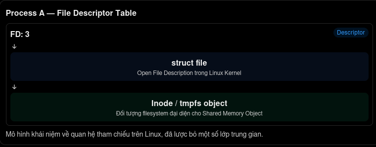

# Kernel : Chuyên đề MAP_SHARED (MAP_SHARED Thematic Research)

**Mục lục**

<table>
<tr>
<td valign="top" width="50%">

- [1.Tổng quan về POSIX Shared Memory](#1tổng-quan-về-posix-shared-memory)
  - [1.1. Shared Memory là gì?](#11-shared-memory-là-gì)
  - [1.2. Shared Memory trong IPC](12-shared-memory-trong-ipc)
     - [1.2.1. IPC là gì?](#121-ipc-là-gì)
	 - [1.2.2. Shared Memory hoạt động như thế nào?](#122-shared-memory-hoạt-động-như-thế-nào)
  - [1.3. So sánh Shared Memory với Pipe, FIFO và Socket](#13-so-sánh-shared-memory-với-pipe-fifo-và-socket)
  - [1.4. Kiến trúc tổng thể giữa User Space và Kernel Space](#14-kiến-trúc-tổng-thể-giữa-user-space-và-kernel-space)
	 - [1.4.1. User Space và Kernel Space là gì?](#141-user-space-và-kernel-space-là-gì)
	 - [1.4.2. Vai trò của User Space trong POSIX Shared Memory](#142-vai-trò-của-user-space-trong-posix-shared-memory)
	 - [1.4.3. Vai trò của Linux Kernel](#143-vai-trò-của-linux-kernel)
- 2.Shared Memory Object
  - 2.1. Shared Memory Object là gì?
  - 2.2. Namespace và tên đối tượng
  - 2.3. File descriptor và vòng đời đối tượng
  - 2.4. Quan hệ giữa Shared Memory Object và Virtual Memory Area
  - 2.5. Backing storage và Page Cache trên Linux
- 3.`shm_open()`
  - 3.1. Function prototype
  - 3.2. Tham số `name`, `oflag`, `mode`
  - 3.3. `O_CREAT`, `O_EXCL`, `O_RDWR`
  - 3.4. Cơ chế tạo và mở Shared Memory Object
  - 3.5. File descriptor được trả về
  - 3.6. Error handling
  - 3.7. Phân tích System Call và Kernel implementation
- 4.`ftruncate()`
  - 4.1. Function prototype
  - 4.2. Tại sao cần thiết lập kích thước?
  - 4.3. Thay đổi kích thước đối tượng shared memory
  - 4.4. Quan hệ giữa object size và mapping length
  - 4.5. File metadata và kernel implementation
  - 4.6. Các lỗi thường gặp
  - 4.7. Phân tích hành vi khi truy cập vùng mapping vượt kích thước đối tượng

</td>
<td valign="top" width="50%">

- 5.`mmap()` với POSIX Shared Memory
  - 5.1. Mapping Shared Memory Object vào Virtual Address Space
  - 5.2. `MAP_SHARED` và `PROT_READ | PROT_WRITE`
  - 5.3. File descriptor trong `mmap()`
  - 5.4. VMA và Page Table
  - 5.5. Demand Paging
  - 5.6. Page Cache và các mapping dùng chung
  - 5.7. Quan sát bằng GDB và `/proc/PID/maps`
- 6.`shm_unlink()`
  - 6.1. Function prototype
  - 6.2. Xóa tên Shared Memory Object
  - 6.3. Khác biệt giữa `shm_unlink()` và `close()`
  - 6.4. Khác biệt giữa `shm_unlink()` và `munmap()`
  - 6.5. Reference counting và vòng đời object
  - 6.6. Khi nào bộ nhớ thực sự được giải phóng?
  - 6.7. Phân tích kernel implementation
- 7.Vòng đời Shared Memory
  - 7.1. Tạo object
  - 7.2. Thiết lập kích thước
  - 7.3. Mapping vào các tiến trình
  - 7.4. Trao đổi dữ liệu
  - 7.5. Đồng bộ hóa giữa các tiến trình
  - 7.6. Unlink và giải phóng tài nguyên
- 8.Đồng bộ hóa (Synchronization)
  - 8.1. Race Condition
  - 8.2. Tín hiệu cờ POSIX (POSIX Semaphore)
  - 8.3. Mutex dùng chung giữa các tiến trình (Process-shared Mutex)
	 - 8.3.1. Mutex là gì?
  - 8.4. Sắp xếp bộ nhớ (Memory Ordering)
  - 8.5. Đồng bộ hóa và tính nhất quán dữ liệu
- 9.Thực nghiệm và Debugging
  - 9.1. Hai tiến trình độc lập sử dụng Shared Memory
  - 9.2. Quan sát Virtual Address Space
  - 9.3. Kiểm tra `/proc/PID/maps`
  - 9.4. Kiểm tra `/proc/PID/smaps`
  - 9.5. GDB: Theo dõi thao tác đọc/ghi
  - 9.6. Theo dõi System Call bằng strace
  - 9.7. Thực nghiệm vòng đời object

</td>
</tr>
</table>

---

## 1.Tổng quan về POSIX Shared Memory
### 1.1. Shared Memory là gì?

là một cơ chế Inter-Process Communication (IPC) cho phép nhiều tiến trình (process) cùng truy cập vào một vùng bộ nhớ chung. Đặc điểm chính
- Nó có tốc độ rất cao vì dữ liệu không cần copy qua kernel (khác với pipe, message queue…).
- Các tiến trình đọc/ghi trực tiếp trên cùng một vùng nhớ.
- Thường dùng kết hợp với cơ chế đồng bộ (semaphore, mutex, condition variable…) để tránh race condition.

Các hàm POSIX chính

<div align="center">

| Hàm | Mục đích |
|:-:|:-|
| `shm_open()` | Tạo hoặc mở một shared memory object |
| `ftruncate()` | Đặt kích thước cho shared memory |
| `mmap()` | Ánh xạ shared memory vào không gian địa chỉ của process |
| `munmap()` | Hủy ánh xạ |
| `shm_unlink()` | Xóa shared memory object |
| `close()` | Đóng file descriptor |

</div>

### 1.2. Shared Memory trong IPC

là một trong những cơ chế giao tiếp giữa các tiến trình (Inter-Process Communication) nhanh nhất.

#### 1.2.1. IPC là gì?

IPC (Inter-Process Communication) là tập hợp các kỹ thuật cho phép các process trao đổi dữ liệu và đồng bộ với nhau. Các cơ chế IPC phổ biến gồm:

<div align="center">

| Cơ chế | Tốc độ | Độ phức tạp | Sao chép dữ liệu | Ghi chú |
|-|-|-|-|-|
| Shared Memory | Rất nhanh | Trung bình | Không | Nhanh nhất |
| Pipe / Named Pipe | Trung bình | Thấp | Có | Dễ dùng |
| Message Queue | Trung bình | Trung bình | Có | Có cấu trúc |
| Socket | Chậm hơn | Cao | Có | Có thể dùng mạng |
| Signal | Nhanh | Thấp | Không | Chỉ thông báo |

</div>

#### 1.2.2. Shared Memory hoạt động như thế nào?

Hệ thống tạo một vùng nhớ chung (shared memory region). Các process ánh xạ (map) vùng nhớ này vào không gian địa chỉ của riêng chúng. Sau đó chúng có thể đọc/ghi trực tiếp trên cùng một vùng nhớ từ đó không cần copy dữ liệu qua kernel.

- **Ưu điểm**
  - Tốc độ cao nhất trong các cơ chế IPC (không phải copy dữ liệu).
  - Phù hợp khi cần truyền lượng dữ liệu lớn hoặc truy cập thường xuyên.
- **Nhược điểm**
  - **Không tự đồng bộ:** Dễ bị race condition nếu không dùng thêm cơ chế đồng bộ (semaphore, mutex, condition variable…).
  - Khó quản lý hơn so với pipe hay message queue.
  - Cần xử lý cẩn thận việc tạo, xóa và quyền truy cập.

### 1.3. So sánh Shared Memory với Pipe, FIFO và Socket

đây là bảng so sánh các cơ chế IPC phổ biến:

<div align="center">

| Tiêu chí | Shared Memory | Pipe (Unnamed) | FIFO (Named Pipe) | Socket |
|-|-|-|-|-|
| Tốc độ | Rất nhanh (nhanh nhất) | Trung bình | Trung bình | Chậm hơn (nhất là network) |
| Sao chép dữ liệu | Không | Có (qua kernel) | Có (qua kernel) | Có (qua kernel) |
| Hướng truyền | Hai chiều (tùy cách dùng) | Một chiều | Một chiều (thường) | Hai chiều |
| Đồng bộ | Phải tự làm (semaphore…) | Kernel hỗ trợ một phần | Kernel hỗ trợ một phần | Kernel hỗ trợ tốt |
| Process liên quan | Bất kỳ process nào | Thường là quan hệ cha-con | Bất kỳ process nào | Bất kỳ (kể cả khác máy) |
| Tồn tại sau khi process kết thúc | Có (cần `shm_unlink`) | Không | Có (nằm trên filesystem) | Không |
| Độ phức tạp lập trình | Cao | Thấp | Trung bình | Trung bình đến cao |
| Phạm vi | Chỉ trong máy | Chỉ trong máy | Chỉ trong máy | Trong máy hoặc qua mạng |
| Kiểu dữ liệu | Bộ nhớ thô (byte) | Byte stream | Byte stream | Stream hoặc Datagram |

</div>

Dựa vào bảng là tóm tắt, chúng ta phân tích chi tiết độ khác nhau giữa 4 cơ chế IPC :

- 1.Shared Memory
  - **Ưu điểm:** Tốc độ cao nhất vì process đọc/ghi trực tiếp trên cùng vùng nhớ, không phải copy dữ liệu.
  - **Nhược điểm:** Không có cơ chế đồng bộ sẵn nên dễ bị race condition. Phải dùng thêm semaphore/mutex.
  - **Phù hợp:** Khi cần truyền dữ liệu lớn hoặc truy cập rất thường xuyên (xử lý ảnh, video, cache…).
- 2.Pipe (Unnamed Pipe)
  - Chỉ dùng được giữa các process có quan hệ (thường là cha – con).
  - Một chiều (một đầu đọc, một đầu ghi).
  - Đơn giản, an toàn hơn Shared Memory vì kernel quản lý buffer.
  - **Phù hợp:** Truyền dữ liệu đơn giản giữa process cha và con.
- 3.FIFO (Named Pipe)
  - Giống Pipe nhưng có tên trong filesystem nên các process không liên quan vẫn dùng được.
  - Vẫn là byte stream, một chiều.
  - Tồn tại trên đĩa (thực ra là special file), nên có thể mở lại sau khi process kết thúc.
  - **Phù hợp:** Khi cần giao tiếp giữa các process độc lập trên cùng máy mà không muốn dùng Shared Memory.
- 4.Socket
  - **Linh hoạt nhất:** dùng được cả local (Unix Domain Socket) lẫn qua mạng (TCP/UDP).
  - Hai chiều, hỗ trợ tốt việc đồng bộ và điều khiển luồng.
  - Chi phí cao hơn vì phải qua nhiều lớp (đặc biệt khi dùng network).
  - **Phù hợp:** Khi cần giao tiếp phức tạp, hoặc giữa các máy khác nhau, hoặc muốn giao diện thống nhất (local + remote).

### 1.4. Kiến trúc tổng thể giữa User Space và Kernel Space
#### 1.4.1. User Space và Kernel Space là gì?

Khái niệm user space (hay còn gọi là userland) là không gian mà các chương trình ứng dụng của người dùng chạy trong hệ điều hành. Đây là không gian người dùng, khá hạn chế và nó ko được phép truy cập tới phần cứng. Cho ví dụ là khi bạn mở một trình duyệt firefox và thao tác trên đó, thì nó đang ở userland, còn mà khi nó muốn gọi hay gửi dữ liệu qua mạng, nó cần call API linux, lúc này system call xuống kernel (trong kernel space) để xử lý giúp 

Khái niệm kernel space (ko gian nhãn) là vùng bộ nhớ và môi trường thực thi dành riêng cho nhân hệ điều hành (kernel). Đây là không gian có đặc quyền cao nhất (privileged mode / ring 0), có quyền truy cập toàn bộ phần cứng: (CPU, RAM, ổ đĩa, card mạng, GPU...) Quản lý tài nguyên hệ thống: bộ nhớ, tiến trình, file system, driver thiết bị, bảo mật…

Code trong kernel space nếu bị lỗi thường làm sập cả hệ thống (kernel panic / BSOD). Chỉ kernel và các module/driver được tải vào kernel mới chạy ở đây.

#### 1.4.2. Vai trò của User Space trong POSIX Shared Memory

Trong kiến trúc POSIX Shared Memory trên Linux, User Space (không gian người dùng) là môi trường thực thi các chương trình ứng dụng có nhu cầu sử dụng cơ chế chia sẻ bộ nhớ giữa nhiều tiến trình (Inter-Process Communication - IPC).Tại đây, chương trình không trực tiếp quản lý Physical Memory hay Page Table của hệ thống. Thay vào đó, nó sử dụng các giao diện lập trình (API) do POSIX cung cấp để yêu cầu Kernel thực hiện những thao tác liên quan đến việc tạo, quản lý và ánh xạ vùng bộ nhớ dùng chung.

Có thể hiểu rằng User Space chịu trách nhiệm đưa ra các yêu cầu và sử dụng vùng Shared Memory sau khi được ánh xạ thành công, trong khi Linux Kernel chịu trách nhiệm quản lý những tài nguyên hệ thống phía sau.

- **a.Chương trình ứng dụng (Application):** Ở User Space, mọi hoạt động sử dụng POSIX Shared Memory đều bắt đầu từ chương trình ứng dụng. **Ví dụ**, một chương trình C có thể sử dụng các thư viện và header sau:

  ```c
  #include <stdio.h>
  #include <stdlib.h>
  #include <fcntl.h>
  #include <sys/mman.h>
  #include <sys/stat.h>
  #include <unistd.h>
  ```

  Các header này cung cấp những khai báo cần thiết để chương trình sử dụng các API liên quan đến POSIX Shared Memory. Một quy trình sử dụng cơ bản:

  ```c
  int fd = shm_open("/my_shm", O_CREAT | O_RDWR, 0666);

  ftruncate(fd, 4096);

  void *ptr = mmap(
      NULL,
      4096,
      PROT_READ | PROT_WRITE,
      MAP_SHARED,
      fd,
      0
  );
  ```

  Trong đoạn chương trình trên:
  - `shm_open()` yêu cầu tạo hoặc mở một Shared Memory Object và trả về file descriptor.
  - `ftruncate()` yêu cầu thiết lập kích thước object thành 4096 bytes.
  - `mmap()` yêu cầu ánh xạ object vào Virtual Address Space của tiến trình.

> [!NOTE]
> **Lưu ý:** Đây là ví dụ minh họa các thao tác API, chưa phải chương trình hoàn chỉnh vì chưa kiểm tra lỗi và giải phóng tài nguyên.

- **b.thư viện C (C Library - glibc):** Các chương trình C thông thường không trực tiếp tự xây dựng cơ chế System Call cho từng thao tác. Thay vào đó, chúng sử dụng các hàm thư viện được cung cấp bởi C Library, chẳng hạn glibc trên Linux. **Ví dụ:**

  ```c
  shm_open();
  ftruncate();
  mmap();
  munmap();
  shm_unlink();
  ```

  Các API này cung cấp giao diện lập trình thuận tiện để ứng dụng tương tác với những cơ chế quản lý tài nguyên của Kernel.

  **Một điểm cần phân biệt:** không nên mặc định rằng mỗi API tương ứng với đúng một System Call. Chẳng hạn, `shm_open()` trên Linux thường được triển khai thông qua các thao tác filesystem như `openat()`, chứ không nhất thiết có một System Call riêng mang tên `shm_open`.
- **c. Quản lý File Descriptor:** Sau khi gọi `shm_open()` thành công, chương trình nhận được một giá trị int đại diện cho File Descriptor (FD). **Ví dụ:**

  ```c
  int fd = shm_open("/my_shm", O_CREAT | O_RDWR, 0666);
  ```

  Giá trị fd là một định danh mà tiến trình sử dụng để tham chiếu đến một file description do Kernel quản lý. File Descriptor cho phép chương trình thực hiện những thao tác tiếp theo trên Shared Memory Object, chẳng hạn:
  - Thiết lập kích thước thông qua `ftruncate()`.
  - Ánh xạ object thông qua `mmap()`.
  - Đóng descriptor thông qua `close()`.

> [!IMPORTANT]
> Điều quan trọng là File Descriptor không phải địa chỉ bộ nhớ của Shared Memory. Nó chỉ là một định danh trong bảng File Descriptor của tiến trình.

- **d. Sử dụng Shared Memory sau khi Mapping:** Sau khi `mmap()` thành công, chương trình nhận được một Virtual Address trỏ đến vùng nhớ đã ánh xạ. **Ví dụ:**

  ```c
  char *ptr = mmap(
      NULL,
      4096,
      PROT_READ | PROT_WRITE,
      MAP_SHARED,
      fd,
      0
  );
  
  if (ptr == MAP_FAILED) {
      perror("mmap");
      exit(EXIT_FAILURE);
  }

  ptr[0] = 'A';
  ptr[1] = 'B';
  ```

  Ở đây, `ptr` là một địa chỉ Virtual Address thuộc không gian địa chỉ của tiến trình hiện tại. Khi chương trình thực hiện `ptr[0] = 'A';`, CPU thực hiện thao tác ghi bộ nhớ thông qua cơ chế dịch địa chỉ Virtual Address sang Physical Address. Nếu trang bộ nhớ tương ứng đã được ánh xạ và truy cập hợp lệ, CPU có thể ghi trực tiếp vào Physical Page tương ứng mà không cần thực hiện một System Call riêng cho mỗi lần ghi.

> [!IMPORTANT]
> **Đây là điểm rất quan trọng:** System Call được sử dụng để thiết lập mapping, nhưng các thao tác đọc/ghi dữ liệu thông thường sau đó diễn ra trực tiếp thông qua cơ chế truy cập bộ nhớ của CPU.

- **e. Trách nhiệm của User Space:** Tổng hợp lại, User Space chịu trách nhiệm:
  - **Application:** Quyết định cách sử dụng Shared Memory
  - **POSIX API:** Cung cấp giao diện thao tác với Shared Memory
  - **C Library:** Cung cấp implementation của API
  - **File Descriptor:** Tham chiếu đến object được Kernel quản lý
  - **Virtual Address:** Địa chỉ để chương trình truy cập vùng mapping
  - **Synchronization:** Tổ chức đồng bộ giữa các process
  - **Error Handling:** Kiểm tra và xử lý lỗi từ các API

User Space không trực tiếp quản lý cách Kernel cấp phát Physical Pages, thiết lập Page Table hay quản lý VMA. Nó chỉ tương tác với những tài nguyên này thông qua các giao diện được hệ điều hành cung cấp.Sau khi mapping thành công, chương trình có thể truy cập dữ liệu thông qua Virtual Address như cách nó truy cập một vùng bộ nhớ thông thường. Chính cơ chế này cho phép nhiều tiến trình độc lập cùng thao tác trên một vùng Physical Memory được chia sẻ.

#### 1.4.3. Vai trò của Linux Kernel

Trong kiến trúc POSIX Shared Memory, Linux Kernel (nhân hệ điều hành Linux) đóng vai trò quản lý và điều phối toàn bộ tài nguyên hệ thống cần thiết để triển khai cơ chế chia sẻ bộ nhớ giữa các tiến trình. Nếu User Space chịu trách nhiệm gọi API, thiết lập yêu cầu và sử dụng vùng nhớ sau khi mapping, thì Kernel chịu trách nhiệm xử lý những yêu cầu đó, quản lý Shared Memory Object, tổ chức ánh xạ bộ nhớ ảo và đảm bảo các tiến trình có thể truy cập đến cùng một vùng dữ liệu vật lý.

Để hiểu rõ hơn, cần phân tích các thành phần mà Kernel quản lý trong quá trình POSIX Shared Memory hoạt động.

- **a. Quản lý Shared Memory Object:** Khi một chương trình gọi `shm_open()`, yêu cầu tạo hoặc mở một Shared Memory Object được chuyển đến Kernel thông qua các giao diện hệ thống. Trên Linux, POSIX Shared Memory thường được triển khai dựa trên `tmpfs`, thường được mount tại `/dev/shm`. **Ví dụ:**

  ```c
   int fd = shm_open("/my_shm", O_CREAT | O_RDWR, 0666);
  ```

  Ở mức triển khai Linux, tên `/my_shm` thường tương ứng với một đối tượng filesystem có tên `my_shm` bên trong `/dev/shm`. Kernel chịu trách nhiệm:
  - Tra cứu tên object trong namespace tương ứng.
  - Kiểm tra quyền truy cập.
  - Tạo mới hoặc mở object đã tồn tại.
  - Quản lý metadata của object.
  - Duy trì các tham chiếu đến object trong suốt vòng đời sử dụng.
  Cần phân biệt rằng Shared Memory Object không đơn giản là một vùng địa chỉ Virtual Memory. Nó là một đối tượng được quản lý bởi Kernel, có thể được nhiều tiến trình mở và ánh xạ vào không gian địa chỉ riêng của chúng.

<details>
	<summary><b>[Câu hỏi]</b> /dev/shm là gì ở linux?</summary>
<table>
<tr>
<td>

---

<sub>--đã hết phần giải thích--</sub>

---

</td>
</tr>
</table>
</details>

- **b. Quản lý File Descriptor và Open File Description:** Sau khi `shm_open()` thành công, Kernel trả về một File Descriptor cho tiến trình gọi. **Ví dụ:**

  ```c
  int fd = shm_open("/my_shm", O_CREAT | O_RDWR, 0666);
  ```

  Giá trị fd được sử dụng làm chỉ mục trong File Descriptor Table của tiến trình. Ở cấp độ kernel, có thể hình dung mô hình mối quan hệ như sau:

  <p align="center">
	
  </p>