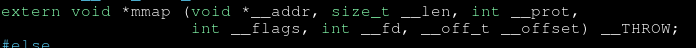

# Kernel: mmap() & munmap()

**Mục lục**

<table>
<tr>
<td valign="top" width="50%">

- [1. Tổng quan về Memory Mapping](#1-tổng-quan-về-memory-mapping)
  - [1.1. Memory Mapping là gì?](#11-memory-mapping-là-gì)
	   - [1.1.1. Virtual Address và physical address](#111-virtual-address-và-physical-address)
	   - [1.1.3. Mối quan hệ giữa phần mềm và địa chỉ bộ nhớ](#113-mối-quan-hệ-giữa-phần-mềm-và-địa-chỉ-bộ-nhớ)
  - [1.2. `mmap()` là gì?](#12-mmap-là-gì)
  - [1.3. `munmap()` là gì?](#13-munmap-là-gì)
  - [1.4. Mối quan hệ giữa `mmap()` và `munmap()`](#14-mối-quan-hệ-giữa-mmap-và-munmap)
  - [1.5. Virtual Memory và Physical Memory](#15-virtual-memory-và-physical-memory)
  - [1.6. Vòng đời của một Memory Mapping](#16-vòng-đời-của-một-memory-mapping)
  	   - [1.6.1. Yêu cầu thiết lập ánh xạ](#161-yêu-cầu-thiết-lập-ánh-xạ)
	   - [1.6.2. Kernel quản lý vùng địa chỉ ảo](#162-kernel-quản-lý-vùng-địa-chỉ-ảo)
	   - [1.6.3. Chương trình truy cập vùng ánh xạ](#163-chương-trình-truy-cập-vùng-ánh-xạ)
	   - [1.6.4. Gỡ bỏ ánh xạ](#164-gỡ-bỏ-ánh-xạ)
- [2. Cơ chế hoạt động ở User Space](#2-cơ-chế-hoạt-động-ở-user-space)
  - [2.1. Khai báo và Prototype của `mmap()`](#21-khai-báo-và-prototype-của-mmap)
  - [2.2. Các tham số của `mmap()`](#22-các-tham-số-của-mmap)
  - [2.3. `addr` và `length`](#23-addr-và-length)
  - [2.4. `prot` và quyền truy cập bộ nhớ](#24-prot-và-quyền-truy-cập-bộ-nhớ)
	   - [2.4.1. `prot` hoạt động như thế nào?](#241-prot-hoạt-động-như-thế-nào)
  - [2.5. `flags`: `MAP_PRIVATE`, `MAP_SHARED` và `MAP_ANONYMOUS`](#25-flags-map_private-map_shared-và-map_anonymous)
  - [2.6. `fd` và `offset`](#26-fd-và-offset)
  - [2.7. Giá trị trả về và xử lý lỗi](#27-giá-trị-trả-về-và-xử-lý-lỗi)
  - [2.8. Khai báo và Prototype của `munmap()`](#28-khai-báo-và-prototype-của-munmap)
  - [2.9. Các tham số `addr` và `length` của `munmap()`](#29-các-tham-số-addr-và-length-của-munmap)
  - [2.10. Giá trị trả về và xử lý lỗi của `munmap()`](#210-giá-trị-trả-về-và-xử-lý-lỗi-của-munmap)

- [3. Từ libc đến Linux Kernel](#3-từ-libc-đến-linux-kernel)
  - [3.1. Lời gọi hàm trong chương trình C](#31-lời-gọi-hàm-trong-chương-trình-c)
  - [3.2. System call `mmap`](#32-system-call-mmap)
  - [3.3. System call `munmap`](#33-system-call-munmap)
  - [3.4. Truyền tham số qua System V AMD64 ABI](#34-truyền-tham-số-qua-system-v-amd64-abi)
  - [3.5. Chuyển từ User Mode sang Kernel Mode](#35-chuyển-từ-user-mode-sang-kernel-mode)
  - [3.6. Theo dõi system call bằng `strace`](#36-theo-dõi-system-call-bằng-strace)

- [4. Cấu trúc quản lý bộ nhớ trong Kernel](#4-cấu-trúc-quản-lý-bộ-nhớ-trong-kernel)
  - [4.1. Virtual Address Space của một tiến trình](#41-virtual-address-space-của-một-tiến-trình)
  - [4.2. Memory Region và Virtual Memory Area (VMA)](#42-memory-region-và-virtual-memory-area-vma)
  - [4.3. `struct mm_struct`](#43-struct-mm_struct)
  - [4.4. `struct vm_area_struct`](#44-struct-vm_area_struct)
  - [4.5. Quan hệ giữa VMA và Page Table](#45-quan-hệ-giữa-vma-và-page-table)
  - [4.6. Quản lý các VMA trong Linux Kernel](#46-quản-lý-các-vma-trong-linux-kernel)

- [5. Cơ chế xử lý `mmap()` trong Kernel](#5-cơ-chế-xử-lý-mmap-trong-kernel)
  - [5.1. Điểm bắt đầu của system call](#51-điểm-bắt-đầu-của-system-call)
  - [5.2. Kiểm tra tham số và cờ ánh xạ](#52-kiểm-tra-tham-số-và-cờ-ánh-xạ)
  - [5.3. Tìm kiếm vùng địa chỉ ảo phù hợp](#53-tìm-kiếm-vùng-địa-chỉ-ảo-phù-hợp)
  - [5.4. Tạo và thiết lập VMA](#54-tạo-và-thiết-lập-vma)
  - [5.5. Ánh xạ Anonymous Memory](#55-ánh-xạ-anonymous-memory)
  - [5.6. Ánh xạ File-backed Memory](#56-ánh-xạ-file-backed-memory)
  - [5.7. Thiết lập quyền truy cập bộ nhớ](#57-thiết-lập-quyền-truy-cập-bộ-nhớ)
  - [5.8. Trả địa chỉ ánh xạ về User Space](#58-trả-địa-chỉ-ánh-xạ-về-user-space)

- [6. Cơ chế xử lý `munmap()` trong Kernel](#6-cơ-chế-xử-lý-munmap-trong-kernel)
  - [6.1. Điểm bắt đầu của system call](#61-điểm-bắt-đầu-của-system-call)
  - [6.2. Kiểm tra địa chỉ và phạm vi cần gỡ ánh xạ](#62-kiểm-tra-địa-chỉ-và-phạm-vi-cần-gỡ-ánh-xạ)
  - [6.3. Xác định các VMA bị ảnh hưởng](#63-xác-định-các-vma-bị-ảnh-hưởng)
  - [6.4. Gỡ bỏ toàn bộ một VMA](#64-gỡ-bỏ-toàn-bộ-một-vma)
  - [6.5. Gỡ bỏ một phần VMA](#65-gỡ-bỏ-một-phần-vma)
  - [6.6. Chia tách VMA khi gỡ ánh xạ ở giữa](#66-chia-tách-vma-khi-gỡ-ánh-xạ-ở-giữa)
  - [6.7. Cập nhật cấu trúc quản lý địa chỉ ảo](#67-cập-nhật-cấu-trúc-quản-lý-địa-chỉ-ảo)

</td>
<td valign="top" width="50%">

- [7. Page Table, Physical Memory và TLB](#7-page-table-physical-memory-và-tlb)
  - [7.1. Virtual Page và Physical Frame](#71-virtual-page-và-physical-frame)
  - [7.2. Page Table Entries (PTE)](#72-page-table-entries-pte)
  - [7.3. Page Fault và Demand Paging](#73-page-fault-và-demand-paging)
  - [7.4. Gỡ bỏ ánh xạ trong Page Table](#74-gỡ-bỏ-ánh-xạ-trong-page-table)
  - [7.5. Anonymous Memory và File-backed Memory](#75-anonymous-memory-và-file-backed-memory)
  - [7.6. Gỡ ánh xạ và giải phóng trang vật lý](#76-gỡ-ánh-xạ-và-giải-phóng-trang-vật-lý)
  - [7.7. TLB và cơ chế Address Translation](#77-tlb-và-cơ-chế-address-translation)
  - [7.8. TLB Invalidation và TLB Shootdown](#78-tlb-invalidation-và-tlb-shootdown)

- [8. Memory Mapping trong thực tế](#8-memory-mapping-trong-thực-tế)
  - [8.1. Anonymous Mapping](#81-anonymous-mapping)
  - [8.2. File-backed Mapping](#82-file-backed-mapping)
  - [8.3. `MAP_PRIVATE` và Copy-on-Write](#83-map_private-và-copy-on-write)
  - [8.4. `MAP_SHARED` và bộ nhớ chia sẻ](#84-map_shared-và-bộ-nhớ-chia-sẻ)
  - [8.5. Memory Mapping và ELF Loader](#85-memory-mapping-và-elf-loader)
  - [8.6. Memory Mapping và Dynamic Linker](#86-memory-mapping-và-dynamic-linker)
  - [8.7. Memory Mapping và cấp phát bộ nhớ động](#87-memory-mapping-và-cấp-phát-bộ-nhớ-động)

- [9. Phân tích mã nguồn Linux Kernel](#9-phân-tích-mã-nguồn-linux-kernel)
  - [9.1. Xác định phiên bản Kernel](#91-xác-định-phiên-bản-kernel)
  - [9.2. Tìm implementation của `mmap()`](#92-tìm-implementation-của-mmap)
  - [9.3. Tìm implementation của `munmap()`](#93-tìm-implementation-của-munmap)
  - [9.4. Truy vết Call Graph](#94-truy-vết-call-graph)
  - [9.5. Phân tích quá trình tạo VMA](#95-phân-tích-quá-trình-tạo-vma)
  - [9.6. Phân tích quá trình cập nhật và xóa VMA](#96-phân-tích-quá-trình-cập-nhật-và-xóa-vma)
  - [9.7. Phân tích xử lý Page Table và TLB](#97-phân-tích-xử-lý-page-table-và-tlb)
  - [9.8. Đối chiếu mã nguồn với thực nghiệm](#98-đối-chiếu-mã-nguồn-với-thực-nghiệm)

- [10. Thực nghiệm bằng C và Linux Tools](#10-thực-nghiệm-bằng-c-và-linux-tools)
  - [10.1. Tạo Anonymous Mapping bằng `mmap()`](#101-tạo-anonymous-mapping-bằng-mmap)
  - [10.2. Ghi và đọc dữ liệu trong vùng ánh xạ](#102-ghi-và-đọc-dữ-liệu-trong-vùng-ánh-xạ)
  - [10.3. Thực thi Machine Code trong vùng nhớ ánh xạ](#103-thực-thi-machine-code-trong-vùng-nhớ-ánh-xạ)
  - [10.4. Quan sát `/proc/<pid>/maps`](#104-quan-sát-procpidmaps)
  - [10.5. Gỡ bỏ toàn bộ Mapping bằng `munmap()`](#105-gỡ-bỏ-toàn-bộ-mapping-bằng-munmap)
  - [10.6. Gỡ bỏ một phần Mapping](#106-gỡ-bỏ-một-phần-mapping)
  - [10.7. Theo dõi bằng `strace`](#107-theo-dõi-bằng-strace)
  - [10.8. Debug bằng GDB](#108-debug-bằng-gdb)
  - [10.9. Kiểm tra hành vi bằng `/proc/<pid>/smaps`](#109-kiểm-tra-hành-vi-bằng-procpidsmaps)

- [11. Lỗi và các trường hợp đặc biệt](#11-lỗi-và-các-trường-hợp-đặc-biệt)
  - [11.1. `MAP_FAILED` và xử lý lỗi](#111-map_failed-và-xử-lý-lỗi)
  - [11.2. Địa chỉ không căn chỉnh theo Page Size](#112-địa-chỉ-không-căn-chỉnh-theo-page-size)
  - [11.3. `length` bằng 0](#113-length-bằng-0)
  - [11.4. Gỡ bỏ một vùng chưa được ánh xạ](#114-gỡ-bỏ-một-vùng-chưa-được-ánh-xạ)
  - [11.5. Truy cập vùng nhớ sau `munmap()`](#115-truy-cập-vùng-nhớ-sau-munmap)
  - [11.6. Lỗi quyền truy cập bộ nhớ](#116-lỗi-quyền-truy-cập-bộ-nhớ)
  - [11.7. Đồng bộ hóa khi nhiều luồng sử dụng Mapping](#117-đồng-bộ-hóa-khi-nhiều-luồng-sử-dụng-mapping)

- [12. Tổng kết và tài liệu tham khảo](#12-tổng-kết-và-tài-liệu-tham-khảo)
  - [12.1. Tóm tắt cơ chế `mmap()`](#121-tóm-tắt-cơ-chế-mmap)
  - [12.2. Tóm tắt cơ chế `munmap()`](#122-tóm-tắt-cơ-chế-munmap)
  - [12.3. Phân biệt VMA, Page Table và Physical Memory](#123-phân-biệt-vma-page-table-và-physical-memory)
  - [12.4. Tổng hợp vòng đời Memory Mapping](#124-tổng-hợp-vòng-đời-memory-mapping)
  - [12.5. Tài liệu tham khảo](#125-tài-liệu-tham-khảo)

</td>
</tr>
</table>

---

## 1. Tổng quan về Memory Mapping

### 1.1. Memory Mapping là gì?

Memory Mapping (ánh xạ bộ nhớ) là cơ chế thiết lập mối quan hệ giữa một vùng địa chỉ ảo trong không gian địa chỉ của tiến trình với bộ nhớ hoặc một đối tượng được ánh xạ, chẳng hạn như một file. Nhờ cơ chế này, tiến trình có thể truy cập dữ liệu thông qua địa chỉ ảo mà không cần trực tiếp quản lý địa chỉ vật lý của RAM.

Trên Linux, `mmap()` là một system-call interface cho phép chương trình yêu cầu kernel thiết lập một vùng ánh xạ trong không gian địa chỉ ảo của tiến trình. Ngược lại, `munmap()` cho phép gỡ bỏ ánh xạ trong một phạm vi địa chỉ được chỉ định.

Để hiểu bản chất của Memory Mapping, trước tiên ta cần phân biệt ba khái niệm: Virtual Address, Physical Address và Memory Mapping.

#### 1.1.1. Virtual Address và Physical Address

Địa chỉ ảo (Virtual Address - VA) và địa chỉ vật lý (Physical Address - PA) là hai loại địa chỉ được sử dụng trong cơ chế quản lý bộ nhớ của hệ thống máy tính.

**Virtual Address (VA)** là địa chỉ thuộc không gian địa chỉ ảo mà tiến trình sử dụng để truy cập bộ nhớ. Trên hệ điều hành hiện đại như Linux, mỗi tiến trình thông thường có không gian địa chỉ ảo riêng. Địa chỉ này được sử dụng để truy cập các vùng bộ nhớ như Stack, Heap, vùng dữ liệu và các vùng ánh xạ khác.

**Physical Address (PA)** là địa chỉ thuộc không gian địa chỉ vật lý. Khi địa chỉ ảo được dịch thành công sang địa chỉ vật lý tương ứng, phần cứng có thể sử dụng địa chỉ vật lý đó để truy cập bộ nhớ vật lý, chẳng hạn như RAM.

Trên hệ thống sử dụng cơ chế phân trang (Paging), CPU phối hợp với bộ phận quản lý bộ nhớ (Memory Management Unit - MMU) để dịch địa chỉ ảo sang địa chỉ vật lý thông qua các cấu trúc Page Table.

Có thể hình dung quá trình này như sau:

```text
             User Space
                 |
                 v
         Virtual Address
           0x7f001000
                 |
                 v
          +-------------+
          |     MMU     |
          |  Address    |
          | Translation |
          +-------------+
                 |
                 | Tra cứu Page Table
                 v
        Physical Address
           0x12345000
                 |
                 v
                RAM
```

Đây là sơ đồ minh họa đơn giản. Các địa chỉ trên chỉ mang tính ví dụ, không đại diện cho một ánh xạ thực tế cụ thể.

> [!NOTE]
> **Điểm cần nhớ:** Chương trình thông thường sử dụng địa chỉ ảo. MMU và Page Table phối hợp để thực hiện quá trình dịch địa chỉ khi CPU truy cập bộ nhớ. Chương trình không cần trực tiếp biết địa chỉ vật lý tương ứng với địa chỉ ảo của mình.

**Cho ví dụ**, khi chương trình C khai báo một biến:

```c
int number = 100;
```

Nếu biến được lưu trong bộ nhớ, địa chỉ lấy được thông qua `&number` trong chương trình thông thường là địa chỉ ảo thuộc không gian địa chỉ của tiến trình.

```c
printf("%p\n", (void *)&number);
```

Giá trị được in ra không phải địa chỉ vật lý của ô RAM đang chứa biến `number`. Nó là địa chỉ mà chương trình sử dụng để tham chiếu đến biến đó.

Cần lưu ý rằng trình biên dịch có thể tối ưu biến vào thanh ghi hoặc loại bỏ việc lưu biến trong bộ nhớ nếu không cần thiết. Vì vậy, ví dụ trên chỉ minh họa trường hợp biến thực sự được lưu trong bộ nhớ.

#### 1.1.2. Phân biệt Memory Mapping, Virtual Address và Physical Address

Dựa trên các khái niệm đã trình bày, ta có thể phân biệt chúng như sau:

<div align="center">

| Khái niệm | Bản chất | Vai trò |
|---|---|---|
| Memory Mapping | Cơ chế thiết lập quan hệ ánh xạ giữa một vùng địa chỉ ảo với bộ nhớ hoặc đối tượng được ánh xạ | Cho phép tiến trình truy cập bộ nhớ hoặc dữ liệu thông qua địa chỉ ảo |
| Virtual Address (VA) | Địa chỉ thuộc không gian địa chỉ ảo của tiến trình | Được chương trình sử dụng để tham chiếu đến dữ liệu hoặc mã lệnh |
| Physical Address (PA) | Địa chỉ thuộc không gian địa chỉ vật lý | Được sử dụng trong quá trình truy cập bộ nhớ vật lý sau khi địa chỉ được dịch thành công |

</div>

Memory Mapping và Virtual Address không phải hai cách gọi của cùng một khái niệm. Virtual Address là một loại địa chỉ, trong khi Memory Mapping là cơ chế thiết lập và quản lý quan hệ ánh xạ.

Tương tự, Physical Address không phải bản thân RAM. Địa chỉ vật lý là địa chỉ trong không gian địa chỉ vật lý; RAM là một loại bộ nhớ vật lý mà hệ thống có thể truy cập thông qua cơ chế địa chỉ này.

Trong hệ thống phân trang, quan hệ giữa địa chỉ ảo và địa chỉ vật lý được quản lý thông qua Page Table. Tuy nhiên, không phải mọi địa chỉ ảo đều luôn có một trang RAM vật lý tương ứng tại mọi thời điểm. Một vùng địa chỉ ảo có thể tồn tại mà các trang của nó chưa được cấp phát vật lý hoặc chưa có ánh xạ vật lý hiện hữu.

#### 1.1.3. Mối quan hệ giữa phần mềm và địa chỉ bộ nhớ

Trên các hệ điều hành hiện đại sử dụng bộ nhớ ảo, chương trình thông thường hoạt động dựa trên không gian địa chỉ ảo do hệ điều hành cung cấp. Điều này có nghĩa là chương trình không cần quản lý trực tiếp vị trí vật lý của dữ liệu trong RAM. Khi chương trình truy cập một địa chỉ ảo, phần cứng và hệ điều hành phối hợp để xử lý việc dịch địa chỉ, quản lý quyền truy cập và xử lý các trường hợp cần thiết như Page Fault.

Vì vậy, không nên nói rằng phần mềm luôn nghĩ địa chỉ ảo chính là địa chỉ vật lý. Chính xác hơn, chương trình thông thường chỉ cần làm việc với địa chỉ trong không gian địa chỉ mà nó được cấp; việc ánh xạ sang địa chỉ vật lý được hệ thống quản lý phía dưới.Đây là một trong những nền tảng quan trọng của cơ chế Memory Mapping trên Linux.

### 1.2. `mmap()` là gì?

`mmap()` (*memory mapping*) là một API trên Linux cho phép chương trình yêu cầu kernel thiết lập một vùng ánh xạ trong không gian địa chỉ ảo của tiến trình.

Thông qua `mmap()`, chương trình có thể tạo vùng bộ nhớ ẩn danh (*anonymous mapping*), ánh xạ nội dung của file vào bộ nhớ (*file-backed mapping*), hoặc thiết lập vùng bộ nhớ phục vụ những mục đích khác.

> [!IMPORTANT]
> **Điểm quan trọng:** `mmap()` không đơn thuần là hàm cấp phát RAM. Nó yêu cầu kernel thiết lập một vùng ánh xạ và các thông tin quản lý liên quan trong không gian địa chỉ ảo của tiến trình. Việc cấp phát hoặc ánh xạ các trang bộ nhớ vật lý có thể diễn ra sau đó, tùy thuộc vào loại ánh xạ và cách chương trình truy cập bộ nhớ.

Ví dụ, khi chương trình yêu cầu ánh xạ 1 MiB bộ nhớ ẩn danh, kernel có thể thiết lập vùng địa chỉ ảo trước mà chưa cần cấp phát ngay toàn bộ các trang vật lý tương ứng.

Khi chương trình truy cập một trang chưa có ánh xạ vật lý phù hợp, CPU có thể phát sinh *page fault*. Kernel sẽ xử lý tình huống này và quyết định cách cung cấp trang bộ nhớ phù hợp.

> Cơ chế cấp phát hoặc đưa trang bộ nhớ vào RAM khi cần thiết có liên quan đến *demand paging* và *page fault*. Tuy nhiên, không phải mọi page fault đều có nghĩa là kernel phải cấp phát một trang RAM mới.

### 1.3. `munmap()` là gì?

`munmap()` (*memory unmapping*) là một API trên Linux cho phép chương trình yêu cầu kernel gỡ bỏ ánh xạ bộ nhớ trong một phạm vi địa chỉ ảo được chỉ định. Thông qua `munmap()`, chương trình có thể gỡ bỏ toàn bộ hoặc một phần của một vùng ánh xạ hiện có, miễn là các tham số đáp ứng yêu cầu của hệ thống.

Sau khi `munmap()` thành công, phạm vi địa chỉ được gỡ bỏ không còn khả dụng thông qua ánh xạ đó. Nếu chương trình tiếp tục truy cập địa chỉ thuộc phạm vi đã gỡ bỏ, việc truy cập có thể gây ra lỗi truy cập bộ nhớ, chẳng hạn như `SIGSEGV`.

Việc gỡ bỏ ánh xạ cũng không nhất thiết đồng nghĩa với việc toàn bộ tài nguyên vật lý liên quan lập tức được giải phóng. Các trang vật lý có thể vẫn được sử dụng hoặc tham chiếu bởi những ánh xạ hay thành phần khác của hệ thống.

### 1.4. Mối quan hệ giữa `mmap()` và `munmap()`

Hai API này có vai trò đối ứng trong việc quản lý vòng đời của một vùng ánh xạ bộ nhớ.

<div align="center">

| `mmap()` | `munmap()` |
|---|---|
| Yêu cầu thiết lập vùng ánh xạ. | Yêu cầu gỡ bỏ ánh xạ trong phạm vi địa chỉ được chỉ định. |
| Trả về địa chỉ bắt đầu của vùng ánh xạ khi thành công. | Trả về `0` khi thành công, hoặc `-1` khi thất bại. |
| Cho phép chương trình sử dụng vùng địa chỉ ảo đã ánh xạ. | Làm cho phạm vi địa chỉ đã gỡ bỏ không còn khả dụng thông qua ánh xạ đó. |

</div>

Có thể hình dung mối quan hệ giữa hai API như sau:

```text
                 mmap()
                   |
                   v
       +------------------------+
       | Thiết lập vùng ánh xạ  |
       | trong không gian VA    |
       +------------------------+
                   |
                   v
       +------------------------+
       | Chương trình truy cập  |
       | vùng địa chỉ đã ánh xạ |
       +------------------------+
                   |
                   v
                munmap()
                   |
                   v
       +------------------------+
       | Gỡ bỏ ánh xạ trong     |
       | phạm vi được chỉ định  |
       +------------------------+
```

**Lưu ý:** Sơ đồ trên mô tả vòng đời khái quát. Một vùng ánh xạ có thể bị gỡ bỏ một phần, và việc gỡ bỏ một mapping không nhất thiết giải phóng ngay toàn bộ các trang vật lý liên quan.

### 1.5. Virtual Memory và Physical Memory

Để hiểu sâu hơn cách `mmap()` và `munmap()` hoạt động, cần phân biệt bộ nhớ ảo (*Virtual Memory*) với bộ nhớ vật lý (*Physical Memory*).

**Virtual Memory** là cơ chế cung cấp cho tiến trình một không gian địa chỉ ảo. Chương trình sử dụng các địa chỉ trong không gian này để tham chiếu đến mã lệnh và dữ liệu.

**Physical Memory** là bộ nhớ vật lý của hệ thống, thường được hiện thực bằng RAM. Khi CPU truy cập bộ nhớ, phần cứng quản lý bộ nhớ sử dụng các cấu trúc dịch địa chỉ để chuyển địa chỉ ảo thành địa chỉ vật lý phù hợp.

Trên Linux, mỗi tiến trình thông thường có không gian địa chỉ ảo riêng. Kernel quản lý các vùng địa chỉ này và thiết lập các thuộc tính cần thiết để kiểm soát cách chương trình sử dụng chúng.

Quá trình dịch địa chỉ có thể được mô tả khái quát như sau:

```text
             Tiến trình
                  |
                  v
          Virtual Address
                  |
                  v
         +----------------+
         |      MMU       |
         | Address        |
         | Translation    |
         +----------------+
                  |
                  | Tra cứu Page Table
                  v
          Physical Address
                  |
                  v
                 RAM
```

Sơ đồ trên mô tả trường hợp địa chỉ ảo được dịch thành công sang địa chỉ vật lý. Trên thực tế, không phải mọi địa chỉ ảo thuộc một vùng đã được thiết lập đều luôn có trang vật lý tương ứng hiện diện trong RAM.

Chẳng hạn, một vùng bộ nhớ ẩn danh được tạo bằng `mmap()` có thể tồn tại trong không gian địa chỉ ảo trước khi tất cả các trang của nó được cấp phát hoặc ánh xạ vật lý.

Khi chương trình truy cập bộ nhớ, nếu việc truy cập cần đến một trang chưa có ánh xạ phù hợp, CPU có thể phát sinh *page fault*. Kernel xử lý lỗi trang dựa trên trạng thái của vùng nhớ, loại ánh xạ và các điều kiện liên quan.

Vì vậy, cần phân biệt ba khái niệm:

| Khái niệm | Vai trò |
|---|---|
| Virtual Memory | Cơ chế quản lý và cung cấp không gian địa chỉ ảo cho tiến trình. |
| Physical Memory | Bộ nhớ vật lý mà hệ thống sử dụng để lưu trữ dữ liệu và mã lệnh khi cần. |
| Memory Mapping | Cơ chế thiết lập mối quan hệ giữa vùng địa chỉ ảo với bộ nhớ hoặc đối tượng được ánh xạ. |

Trong bối cảnh này, `mmap()` là API để chương trình yêu cầu kernel thiết lập một vùng ánh xạ, còn `munmap()` là API để yêu cầu gỡ bỏ ánh xạ đó trong một phạm vi nhất định.

### 1.6. Vòng đời của một Memory Mapping

Một vùng ánh xạ bộ nhớ trên Linux có thể trải qua nhiều giai đoạn, từ lúc chương trình yêu cầu tạo mapping cho đến khi ánh xạ bị gỡ bỏ.

#### 1.6.1. Yêu cầu thiết lập ánh xạ

Chương trình gọi `mmap()` với các tham số xác định địa chỉ đề xuất, kích thước, quyền truy cập, loại ánh xạ và thông tin file nếu cần.

Kernel kiểm tra các tham số và điều kiện liên quan. Nếu yêu cầu hợp lệ, kernel thiết lập vùng địa chỉ ảo tương ứng và trả về địa chỉ bắt đầu của vùng ánh xạ.

#### 1.6.2. Kernel quản lý vùng địa chỉ ảo

Kernel quản lý vùng địa chỉ này thông qua các cấu trúc dữ liệu bộ nhớ ảo. Trên Linux, `vm_area_struct` mô tả một vùng địa chỉ ảo có các thuộc tính quản lý liên quan; vùng này thường được gọi là VMA (*Virtual Memory Area*).

Thông tin VMA có thể bao gồm phạm vi địa chỉ, quyền truy cập và các thông tin liên quan đến loại ánh xạ.

Việc một VMA tồn tại không có nghĩa mọi trang trong phạm vi của nó đều đã được ánh xạ đến các trang vật lý trong RAM.

#### 1.6.3. Chương trình truy cập vùng ánh xạ

Sau khi `mmap()` thành công, chương trình có thể sử dụng địa chỉ được trả về để truy cập bộ nhớ, trong giới hạn quyền truy cập đã thiết lập.

Tùy thuộc vào loại ánh xạ và trạng thái hiện tại, việc truy cập có thể sử dụng ánh xạ trang đã tồn tại hoặc phát sinh *page fault* để kernel xử lý.

Ví dụ, với một vùng bộ nhớ ẩn danh, kernel có thể cung cấp trang vật lý khi chương trình lần đầu truy cập một trang chưa được cấp phát theo cơ chế của hệ thống.

#### 1.6.4. Gỡ bỏ ánh xạ

Khi không còn cần vùng bộ nhớ, chương trình có thể gọi `munmap()` để yêu cầu kernel gỡ bỏ ánh xạ trong phạm vi tương ứng.

Kernel cập nhật các cấu trúc quản lý bộ nhớ và xử lý những ánh xạ trang liên quan. Nếu chỉ gỡ bỏ một phần của vùng ánh xạ, phần còn lại có thể tiếp tục tồn tại.

Các trang vật lý liên quan chỉ được giải phóng khi không còn cần thiết và không còn được tham chiếu theo các cơ chế quản lý bộ nhớ của hệ thống.

Có thể tóm tắt vòng đời như sau:

```text
        Chương trình gọi mmap()
                  |
                  v
       Kernel thiết lập mapping
                  |
                  v
       Vùng địa chỉ ảo tồn tại
                  |
                  v
       Chương trình truy cập
           vùng ánh xạ
                  |
                  v
       Có thể phát sinh page fault
           nếu cần xử lý trang
                  |
                  v
       Chương trình gọi munmap()
                  |
                  v
       Kernel gỡ bỏ ánh xạ
       trong phạm vi yêu cầu
```

Vòng đời thực tế phụ thuộc vào loại ánh xạ, trạng thái các trang, việc chia sẻ tài nguyên và các hoạt động quản lý bộ nhớ khác. Vì vậy, không nên hiểu rằng mỗi lần gọi `mmap()` đều lập tức cấp phát RAM, hoặc mỗi lần gọi `munmap()` đều lập tức giải phóng toàn bộ RAM liên quan.

## 2. Cơ chế hoạt động ở User Space
### 2.1. Khai báo và Prototype của `mmap()`

Prototype của `mmap()` là các tiền tố, tham số khai báo của hàm `mmap()`:

<p align="center">

</p>

các kiểu dữ liệu quan trọng trong prototype:

<div align="center">

| Thành phần | Ý nghĩa |
|---|---|
| `void *` | Kiểu con trỏ tổng quát; ở đây là kiểu giá trị trả về, dùng để biểu diễn địa chỉ bắt đầu của vùng ánh xạ. |
| `size_t` | Kiểu số nguyên không dấu dùng để biểu diễn kích thước. |
| `int` | Kiểu dữ liệu dùng cho các tham số `prot` và `flags`. |
| `off_t` | Kiểu dữ liệu dùng để biểu diễn offset trong file. |

</div>

**Lưu ý:** `mmap()` là API được khai báo trong thư viện C trên Linux, lời gọi này thường được thực hiện thông qua system call tương ứng để yêu cầu kernel xử lý.

### 2.2. Các tham số của `mmap()`

`mmap()` bao gồm có 6 tham số, ta xét bảng sau :

<div align="center">

| Tham số | Chức năng |
|---|---|
| `addr` | Địa chỉ ảo đề xuất cho vùng ánh xạ. |
| `length` | Kích thước vùng ánh xạ tính bằng byte. |
| `prot` | Quy định các quyền truy cập bộ nhớ được yêu cầu. |
| `flags` | Xác định loại ánh xạ và các thuộc tính liên quan. |
| `fd` | File descriptor của đối tượng file cần ánh xạ, nếu có. |
| `offset` | Vị trí bắt đầu trong file cần ánh xạ. |

</div>

Từ bảng này, ta có thể nhóm tham số theo chức năng: vị trí và kích thước (`addr`, `length`), quyền truy cập (`prot`), loại ánh xạ (`flags`) và thông tin file (`fd`, `offset`).

### 2.3. `addr` và `length`

tham số `addr` là địa chỉ ảo mà chương tình đề xuất làm địa chỉ bắt đầu của vùng ánh xạ. Ở đây, chúng ta có hai trường hợp:
- **Trường hợp 1:** Là cung cấp vào cho tham số `addr` là `NULL`, ví dụ `mmap(NULL,...)` thì điều này chương trình sẽ cho kernel tùy chọn địa chỉ ảo phù hợp để bắt đầu của vùng ánh xạ mà ko có đề xuất gì hết
- **Trường hợp 2:** Là cung cấp vào cho tham số `addr` là một địa chỉ ảo nào đó ví dụ `0xf000f123` như `mmap(0xf000f123,...)` thì điều này chương trình sẽ đề xuất địa chỉ `0xf000f123` cho kernel để làm địa chỉ ảo bắt đầu của vùng ánh xạ

> [!IMPORTANT]
> **Lưu ý:** địa chỉ `0xf000f123` chỉ thuộc dạng đề xuất, khi chương trình thực thi ko thể đảm bảo nó hoạt động, nghĩa là địa chỉ `0xf000f123` sẽ ko đảm bảo luôn là làm địa chỉ ảo bắt đầu của vùng ánh xạ. Vì kernel có thể chọn các địa chỉ khác

Ví dụ minh họa, nếu dùng `NULL` truyền vào tham số `addr` thì kernel có thể trả về địa chỉ `0x7f100000`:

```
Không gian địa chỉ ảo của tiến trình

0x7f0fffff  ───────────────
0x7f100000  ┌──────────────┐  ◄── mem
            │              │
            │   Mapping    │
            │              │
0x7f100fff  └──────────────┘
0x7f101000  ───────────────
```

Địa chỉ trên chỉ là ví dụ, không phải địa chỉ cố định mà `mmap()` luôn trả về. Còn về trường hợp 2 là trường hợp gắn một địa chỉ vào tham số `addr` để chương trình đề xuất thì trong cách sử dụng thông thường, địa chỉ được gán thẳng vào tham số `addr` chỉ là gợi ý cho kernel. Kernel có thể chọn địa chỉ khác nếu không thể sử dụng địa chỉ được đề xuất. Các cờ đặc biệt như `MAP_FIXED` và `MAP_FIXED_NOREPLACE` thay đổi cách xử lý địa chỉ này. Chúng có ngữ nghĩa riêng và cần được hiểu kỹ trước khi sử dụng.

> [!NOTE]
> **Điểm cần nhớ:** `addr` không phải địa chỉ vật lý của RAM. Đây là địa chỉ thuộc không gian địa chỉ ảo của tiến trình.

Còn tham số `length` xác định kích thước vùng ánh xạ mà chương trình yêu cầu, tính bằng byte. **Ví dụ**, cho đoạn `mmap(NULL, 4096,...)`, trong đó tham số `addr` là `NULL` nên kernel sẽ chọn địa chỉ bắt đầu để ánh xạ, tham số `length` là `4096` tương đương `4` KiB

vậy nghĩa của cái này trước tiên là yêu cầu ánh xạ một vùng có kích thước `4096` byte, tương đương `4` KiB. Giả sử kernel trả về địa chỉ bắt đầu 0x7f100000, vùng địa chỉ được yêu cầu có thể minh họa như sau:

```
Địa chỉ bắt đầu                       Địa chỉ cuối
     0x7f100000                          0x7f100fff
          │                                   │
          ▼                                   ▼
          ┌───────────────────────────────────┐
          │                                   │
          │       4096 bytes = 4 KiB          │
          │                                   │
          └───────────────────────────────────┘
```

Cách tính địa chỉ cuối của vùng có kích thước length là `last vaddr = addr + length - 1` vậy suy ra từ ví dụ trên, ta xét `0x7f100000 + 4096 - 1 = 0x7f100fff`

**Lưu ý:** Đây là địa chỉ cuối của phạm vi byte được minh họa; trong C, thông thường người ta biểu diễn phạm vi bộ nhớ bằng khoảng nửa mở `[addr, addr + length)`. Nghĩa là địa chỉ bắt đầu được tính vào phạm vi, còn địa chỉ ngay sau vùng ánh xạ thì không.

- **`length` có bắt buộc là bội số của kích thước trang không?:** Không. `length` không nhất thiết phải là bội số của kích thước trang. **Ví dụ** cho đoạn code `size_t length = 1000;`

  Chương trình có thể yêu cầu ánh xạ 1000 byte. Kernel quản lý ánh xạ theo các đơn vị trang và các quy tắc liên quan, nên phạm vi được quản lý có thể bao phủ nhiều byte hơn kích thước yêu cầu sau khi làm tròn theo ranh giới trang.

  Điều này không có nghĩa chương trình được phép tùy ý truy cập vượt quá phạm vi ánh xạ mà nó yêu cầu.

`addr` và `length` là hai tham số có mối quan hệ mật thiết với nhau vì hai tham số này xác định phạm vi địa chỉ ảo mà chương trình muốn sử dụng. Tham số `addr` là đề xuất hoặc để kernel chọn nếu là `NULL` một địa chỉ ảo bắt đầu của vùng ánh xạ, tham số `length` là xác định kích thước vùng ánh xạ mà chương trình yêu cầu, tính bằng byte. Khi đầy đủ hai tham số này, ta có thể tính ra `last vaddr` (địa chỉ ảo kết thúc của vùng ánh xạ)

### 2.4. `prot` và quyền truy cập bộ nhớ

tham số `prot` (protection) xác định các quyền truy cập mà một vùng bộ nhớ được phép có trong không gian địa chỉ ảo của tiến trình. Nói cách khác, prot cho biết CPU được phép đọc, ghi hoặc thực thi dữ liệu trong vùng bộ nhớ đó. Linux cung cấp các hằng số `prot` sau trong `<sys/mman.h>` :

<div align="center">

| Hằng số | Giá trị | Ý nghĩa |
|---|---:|---|
| `PROT_READ` | `0x1` | Cho phép đọc dữ liệu |
| `PROT_WRITE` | `0x2` | Cho phép ghi dữ liệu |
| `PROT_EXEC` | `0x4` | Cho phép thực thi lệnh máy |
| `PROT_NONE` | `0x0` | Không cho phép truy cập thông thường |

</div>

Các quyền này có thể kết hợp bằng toán tử bitwise OR (`|`). **Ví dụ**, `PROT_READ | PROT_WRITE` tương đương `0x1 | 0x2 = 0x3`, Vì vậy, `prot = 3` có nghĩa là vùng bộ nhớ được cấp quyền đọc và ghi.

> [!NOTE]
> **Lưu ý:** `PROT_NONE` có giá trị bằng `0`, nên không thể kết hợp nó với các quyền khác để tạo thành một tập quyền có ý nghĩa.

#### 2.4.1. `prot` hoạt động như thế nào?

để hiểu cách `prot` hoạt động, trước hết ta cần xét lời gọi `mmap()` như sau:

```c
void *mem = mmap(
    NULL,
    4096,
    PROT_READ | PROT_WRITE,
    MAP_PRIVATE | MAP_ANONYMOUS,
    -1,
    0
);
```

Ở đây ta có `PROT_READ | PROT_WRITE` là `prot` của lời gọi `mmap()`, nghĩa là khi cái hàm này nó cấp một vùng địa chỉ bắt đầu của vùng ánh xạ có kích thước 4KiB do kernel chỉ định, thì cái vùng ánh xạ đó nó được phép chế độ đọc-ghi. Giả sử `mmap()` trả về địa chỉ ảo `mem = 0x7ffff7f8f000`, sau đó, chương trình thực hiện:

```c
*(int *)mem = 123;
int value = *(int *)mem;
```

Quá trình truy cập diễn ra như sau, đầu tiên là ghi dữ liệu `mov DWORD PTR [rax], 0x7b`, lúc này CPU ghi giá trị `123` vào địa chỉ ảo mà `RAX` đang giữ. Tiếp theo là đọc dữ liệu `mov eax, DWORD PTR [rax]`, CPU đọc 4 byte từ địa chỉ ảo đó vào thanh ghi `EAX`. Cả hai thao tác đều phù hợp với quyền `PROT_READ | PROT_WRITE`.

- **Nếu quyền truy cập không phù hợp thì sao?:** Ví dụ, vùng bộ nhớ chỉ được cấp quyền đọc `PROT_READ`. Nếu chương trình cố ghi vào vùng này, CPU có thể phát sinh `page fault` do vi phạm quyền truy cập. Kernel xử lý ngoại lệ, nếu truy cập vẫn không hợp lệ, chương trình thường nhận `SIGSEGV`.

  Tương tự, nếu vùng nhớ không có quyền `PROT_EXEC`, việc lấy lệnh máy từ vùng đó để thực thi thông thường sẽ bị ngăn chặn. Tuy nhiên, cần phân biệt hai trường hợp:
  - **Page fault không đồng nghĩa với lỗi chương trình:** nó cũng có thể xảy ra khi CPU truy cập một trang chưa được đưa vào RAM và kernel có thể xử lý thành công.
  - **Vi phạm quyền truy cập:** nếu thao tác không được phép và kernel không thể xử lý nó như một truy cập hợp lệ, tiến trình thường bị gửi SIGSEGV.

<details>
	<summary><b>[Thực hành]</b> Debug để bắt và phát hiện lỗi quyền truy cập ko phù hợp trong GDB</summary>
<table>
<tr>
<td>

---

<sub>--đã hết phần giải thích--</sub>

---

</td>
</tr>
</table>
</details>

### 2.5. `flags`: `MAP_PRIVATE`, `MAP_SHARED` và `MAP_ANONYMOUS`
### 2.6. `fd` và `offset`
### 2.7. Giá trị trả về và xử lý lỗi
### 2.8. Khai báo và Prototype của `munmap()`
### 2.9. Các tham số `addr` và `length` của `munmap()`
### 2.10. Giá trị trả về và xử lý lỗi của `munmap()`